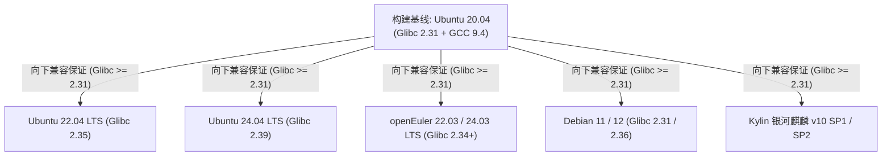

# 01 - 项目背景与代际断层分析 (Project Overview & Background)

## 一、为什么需要在 2026 年开发 JDK 8u RISC-V Port？

### 1.1 业务与技术驱动力
* **企业存量 Java 8 系统的长期生命周期**：
  在全球金融核心交易系统、电信计费、大型政企云平台、大数据集群（Hadoop 2.x/3.x, Spark 2.x, Flink, HBase）中，仍有数以亿计的存量 Java 8 生产业务代码在稳定运行。由于第三方闭源库依赖、框架兼容性以及高昂的回归测试成本，这些系统在短期内无法完成向 JDK 17/21 的大版本迁移。
* **RISC-V 服务器与数据中心硬件的爆发式落地**：
  以中科院香山（XiangShan 南湖/昆明湖）、阿里平头哥玄铁（XuanTie C910/C920）、硅谷 Ventana Veyron、算能（Sophgo SG2042）为代表的高性能服务器级 RISC-V 芯片正大规模进入数据中心与边缘计算节点。
* **历史断层与生态真空**：
  OpenJDK 官方的 RISC-V 端口（JEP 422）在 **2022 年（JDK 19）** 正式合入主线，随后官方维护团队仅将其向后移植（Backport）至 JDK 17u 和 JDK 11u，**JDK 8u 官方代码仓（`riscv-port-jdk8u`）长期停滞，处于仅有架构空壳的状态**。本项目旨在填补这一关键工业生态空白，实现功能完整、性能比肩现代 JDK 的 JDK 8u RISC-V 原生端口。

---

## 二、官方主线端口与 JDK 8u 的四大底层架构鸿沟

在主线已有一套高度成熟的 RISC-V 端口（位于本地 [`/Users/wujiahua/code/jdk/src/hotspot/cpu/riscv`](file:///Users/wujiahua/code/jdk/src/hotspot/cpu/riscv)）的前提下，将代码向后移植到 JDK 8u 必须跨越 HotSpot 在过去十年间发生的四次重大微架构重构：

### 2.1 垃圾回收器屏障系统（GC Barrier Interface）的断代
* **现代 JDK（JDK 11+ JEP 304）**：
  引入了高度抽象的 `BarrierSetAssembler` 接口（如 `G1BarrierSetAssembler`, `ZGCBarrierSetAssembler`）。所有 GC 屏障的汇编发射均被彻底解耦，集中在独立类中维护。
* **JDK 8u**：
  **完全不存在统一的屏障汇编接口！** GC 屏障硬编码在 `MacroAssembler`、C1 编译器的 `c1_LIRAssembler` 以及 C2 编译器的 `.ad` 架构描述文件规则中。
* **CMS 的特殊性**：
  现代 JDK 早在 JDK 14 就彻底删除了 CMS（Concurrent Mark Sweep），官方主线 RISC-V 端口代码库中**没有任何现成的 CMS 汇编支持**。但在 JDK 8u 中，CMS 是支撑低延迟业务的绝对主力，必须基于卡表写屏障从头完成 RISC-V 适配。

### 2.2 线程调度与安全点机制（Safepoint Mechanism）断代
* **现代 JDK（JDK 10+ JEP 312）**：
  支持线程局部握手（Thread-local Handshakes）与基于线程本地寄存器/私有页的安全点检测（`Thread::polling_page()`），无需挂起整个进程即可执行细粒度操作。
* **JDK 8u**：
  采用经典的**单全局安全点轮询页（Global Polling Page）**。进入安全点时，JVM 内存管理系统通过 `mprotect` 将全局只读页置为不可访问，正在运行 JIT 编译代码的工作线程在读取该全局页时触发硬件 `SIGSEGV`，由信号处理例程（`os_linux_riscv.cpp`）捕获并将线程转移至慢速停顿路径。

### 2.3 动态自修改代码（Self-Modifying Code）与入口保护断代
* **现代 JDK（JDK 21+ JDK-8358821）**：
  已彻底消灭了并发修补可执行机器码的机制，移除了 `patch_verified_entry`，全面采用 **NMethod Entry Barrier**（在方法序言执行轻量内存状态字检查，通过 CAS/原子翻转标志实现方法反优化与去优化）。
* **JDK 8u**：
  依然深度依赖传统的代码直接覆盖机制（`NativeJump::patch_verified_entry`）。在方法从 `compiled` 切换到 `not_entrant` 时，多线程并发直接向方法入口覆写一条跳转指令或非法指令。该机制与 RVC（16位压缩指令）存在极高的缓存行跨界冲突风险，必须进行严格的 4 字节自然对齐加固。

### 2.4 代码拓扑与构建系统断代
* **现代 JDK**：
  代码统一放置在 `src/hotspot/cpu/riscv` 与 `src/hotspot/os_cpu/linux_riscv`；模块化构建系统高度统一。
* **JDK 8u**：
  HotSpot 仍作为独立的古老子仓（`hotspot/`），源码位于 `hotspot/src/cpu/riscv/vm/` 和 `hotspot/src/os_cpu/linux_riscv/vm/`；依赖基于 GNU make 递归的旧式目录树建立过程（`buildtree.make`、`flags.make`、`platform_<arch>`）。

---

## 三、二进制分发与向下兼容性哲学（The Glibc Baseline）

本项目在 Apple Silicon Mac 上搭建的交叉编译环境以 **Ubuntu 20.04 (Focal Fossa)** 为底层容器基准，这是基于工业级生产实践深思熟虑的架构决策：

### 3.1 Glibc 动态链接器符号版本控制（Symbol Versioning）
* Linux Glibc 严格遵循**向上兼容（Forward Compatible）、向下断裂（Backward Incompatible）**原则。
* 在高版本 Glibc 系统（如 Ubuntu 24.04, Glibc 2.39）上编译出的二进制文件，其 ELF 符号表会被打上 `GLIBC_2.38` 等高版本标签，直接拷贝到较低版本的客户服务器时，动态链接器会报错并终止进程。
* 选定 **Ubuntu 20.04（Glibc 2.31）** 构建出的 `libjvm.so` 与 `java` 启动器，其符号依赖锁定在 `GLIBC_2.31`。任何在 2020 年之后发布的 RISC-V Linux 发行版（Glibc 版本普遍在 2.31 ~ 2.40 之间）均能**免安装、直接解压运行**。

### 3.2 C++ 静态内联与零系统依赖
* **libstdc++ 静态链接**：HotSpot 默认以 `-static-libstdc++` 链接，C++ 运行时完全内嵌于 `libjvm.so`，彻底屏蔽了目标系统 GCC 运行库版本的差异。
* **Headless 纯净依赖**：通过 `--disable-headful` 剥离了图形桌面库（X11, ALSA, CUPS），且 zlib 采用内嵌源码模式（`--with-zlib=bundled`）。最终产物仅依赖 Linux 最基础的 `libc.so.6`, `libm.so.6`, `libdl.so.2`, `libpthread.so.0`。

### 3.3 纯 Java 与 Native .so 责任边界
* **纯 Java 应用（95% 场景）**：
  Java 字节码具有天然的平台无关性（Write Once, Run Anywhere）。Spring Boot、Kafka、ZooKeeper、Tomcat 等字节码应用打包出的 Jar 包，在 RISC-V JDK 8u 上无需任何修改或重新打包即可原生运行。
* **含 JNI Native .so 的应用**：
  如 Netty epoll 优化库、RocksDB JNI、Snappy JNI。属于应用自身层面的 C/C++ 动态库编译问题，使用本项目配套的 `riscv64-linux-gnu-gcc` 交叉编译工具链将对应的 C 源码编译为 RISC-V 目标后替换 Jar 内 native so 即可，不涉及 JVM 引擎内部改造。
