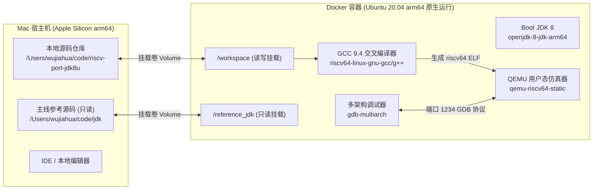
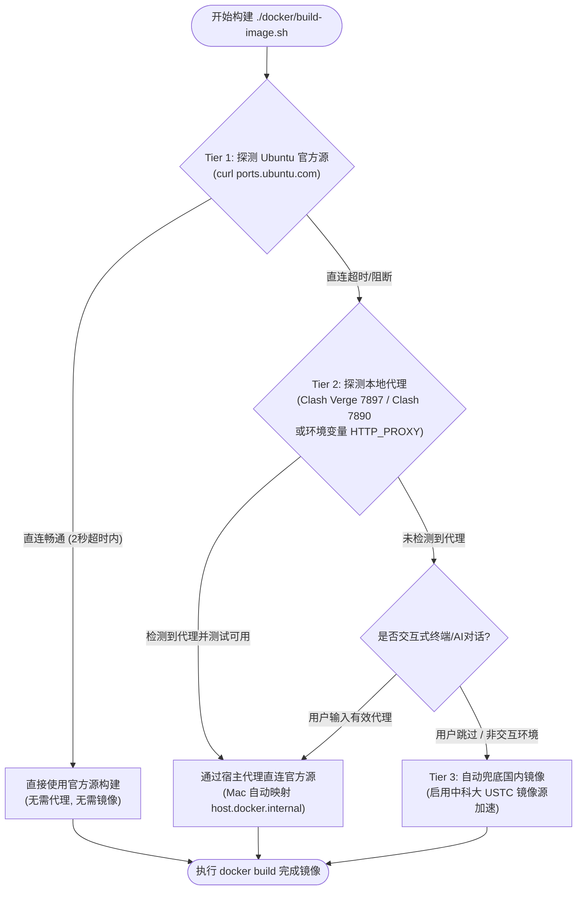
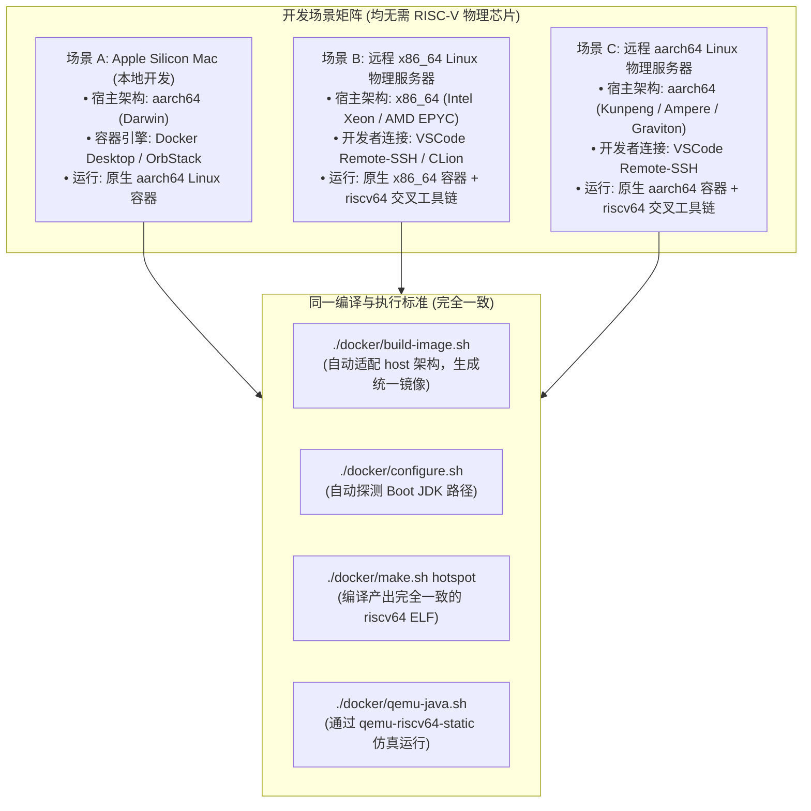

# 02 - Docker 交叉开发与调试环境搭建指南 (Dev Environment Setup)

本文档旨在供 **人类开发者** 与 **AI Coding Agent** 快速在 Apple Silicon Mac（Darwin aarch64）上拉起全套开箱即用的 JDK 8u RISC-V 交叉编译、运行与指令级单步调试流水线。

---

## 一、环境拓扑与架构设计



* **原生性能**：构建容器本身为 `linux/arm64`，直接在 Apple Silicon 物理核心上原生执行，编译吞吐极高（几十秒内完成 HotSpot 全量编译），完全避免了在 macOS 宿主层直接模拟 x86 或 RISC-V 编译器的巨幅性能损耗。
* **隔离与便携**：所有 Linux 系统级构建依赖（bison, flex, x11, alsa, cups, gawk）全部封印在容器镜像内，宿主机 Mac 仅需安装 Docker Desktop 或 OrbStack。

---

## 二、工具箱脚本清单（全部位于 `docker/` 目录）

项目在 [`docker/`](file:///Users/wujiahua/code/riscv-port-jdk8u/docker) 提供了全流程开箱即用脚本（均已具备 `+x` 权限）：

| 脚本路径 | 作用说明 | 典型执行示例 |
| :--- | :--- | :--- |
| [`docker/build-image.sh`](file:///Users/wujiahua/code/riscv-port-jdk8u/docker/build-image.sh) | 构建或重新构建 `jdk8u-riscv-builder:latest` 基础镜像 | `./docker/build-image.sh` |
| [`docker/shell.sh`](file:///Users/wujiahua/code/riscv-port-jdk8u/docker/shell.sh) | 以交互式 Bash 终端进入容器环境，挂载源码与参考库 | `./docker/shell.sh` |
| [`docker/configure.sh`](file:///Users/wujiahua/code/riscv-port-jdk8u/docker/configure.sh) | 执行 RISC-V 目标配置，生成 Makefile | `./docker/configure.sh slowdebug` |
| [`docker/make.sh`](file:///Users/wujiahua/code/riscv-port-jdk8u/docker/make.sh) | 在容器中并发执行编译 | `./docker/make.sh hotspot` 或 `images` |
| [`docker/qemu-java.sh`](file:///Users/wujiahua/code/riscv-port-jdk8u/docker/qemu-java.sh) | 通过 QEMU 用户态仿真直接运行编译生成的 `java` | `./docker/qemu-java.sh -version` |
| [`docker/qemu-gdb.sh`](file:///Users/wujiahua/code/riscv-port-jdk8u/docker/qemu-gdb.sh) | 启动 QEMU GDBServer 并自动附加 `gdb-multiarch` | `./docker/qemu-gdb.sh -version` |

---

## 三、新人 / AI Coding Agent 快速上手指南（四步走）

如果你是一位刚接触该项目的工程师，或者协助开发的环境搭建 Agent，只需在项目根目录按顺序执行以下指令：

### 第 1 步：确认 Docker 引擎可用
在 Mac 宿主终端执行：
```bash
docker version
```
确保客户端与服务端正常连通（架构显示为 `linux/arm64`）。若提示 `command not found: docker`，请确认已启动 Docker Desktop 或 OrbStack，并将 `$HOME/.docker/bin` 加入 `PATH`。

### 第 2 步：构建 Docker 开发镜像（内置三级智能网络与 AI Agent 协同策略）
```bash
bash ./docker/build-image.sh
```
为了兼顾不同开发者的网络环境（直连、公司代理、国内镜像），镜像构建脚本内置了**三级智能网络路由策略（3-Tier Network Strategy）**：



* **Tier 1 (首选直连)**：首先探测能否直连官方源 `ports.ubuntu.com`。若直连顺畅，以 100% 纯净官方源完成构建；
* **Tier 2 (代理穿透)**：若直连受阻，脚本会自动嗅探宿主机代理端口（Mac 常见 Clash Verge 7897、Clash 7890 等，并自动映射为容器内可达的 `host.docker.internal:<port>`）。若在交互式终端下未嗅探到，会主动提示用户输入代理；
* **Tier 3 (镜像兜底)**：若开发者无代理或直接回车跳过，脚本自动平滑回退至国内高可用镜像源（中科大 USTC 镜像），确保环境构建绝不中断；
* **产出镜像**：`jdk8u-riscv-builder:latest`。

#### AI Coding Agent 新人引导规范（Network Onboarding SOP）
当同事拉起一个全新的 AI Coding Agent（如 Claude Code / Antigravity / Cline 等）协助搭建环境时，Agent 应遵循以下标准化工作流：
1. **自动执行构建**：直接执行 `bash ./docker/build-image.sh`；
2. **感知网络状态**：
   * 若输出 `[Tier 1 命中]`，Agent 无需打扰用户，继续执行配置；
   * 若输出 `[Tier 2 命中]`，已自动复用用户的本地代理（如 Clash Verge 7897），无需人工干预；
   * 若直连与自动探测均失败，且环境处于无代理状态，Agent 可主动向同事询问：*“检测到直连官方源超时，请问本地是否有 HTTP 代理（如 Clash Verge 端口）？若有可提供给我；若无，我将为您自动启用国内中科大镜像完成极速构建。”*
   * 若同事提供了代理（如 `http://127.0.0.1:7897`），Agent 可通过环境变量传参执行：`PROXY=http://127.0.0.1:7897 bash ./docker/build-image.sh`；若同事未提供或没有代理，Agent 直接让脚本回退到 Tier 3 镜像兜底，确保构建闭环。

### 第 3 步：运行初次 Configure
```bash
bash ./docker/configure.sh slowdebug
```
* 配置成功后，会生成 `build/linux-riscv64-normal-server-slowdebug/` 目录以及 `spec.gmk`、`hotspot-spec.gmk`；
* 核心参数校验点：
  * `OpenJDK target: OS: linux, CPU architecture: riscv, address length: 64`
  * `C Compiler: Version 9.4.0 (at /usr/bin/riscv64-linux-gnu-gcc)`
  * `Boot JDK: openjdk version "1.8.0_452"`

### 第 4 步：编译与执行验证
```bash
# 仅编译 HotSpot 核心虚拟机
bash ./docker/make.sh hotspot

# 验证 QEMU 执行
bash ./docker/qemu-java.sh -version
```

---

## 四、调试工作流：GDB 多架构单步汇编调试

当我们在实现汇编发射或模板解释器时，需要观察 RISC-V 虚拟 CPU 的通用寄存器（`x0~x31`）状态与 PC 指针：

1. **直接启动调试脚本**：
   ```bash
   bash ./docker/qemu-gdb.sh -version
   ```
2. **底层原理**：
   * 脚本在后台启动 `qemu-riscv64-static -g 1234 -cpu rv64,c=true,v=true`；
   * 自动在容器前台唤起 `gdb-multiarch`；
   * 自动执行以下 GDB 初始化指令：
     ```gdb
     set architecture riscv:rv64
     target remote localhost:1234
     set sysroot /usr/riscv64-linux-gnu
     ```
3. **常用调试命令**：
   ```gdb
   b StubGenerator_generate_initial
   b MacroAssembler::align
   layout asm
   layout regs
   stepi
   info registers
   ```

---

## 五、Autoconf 规则修改注意事项

当修改了 [`common/autoconf/`](file:///Users/wujiahua/code/riscv-port-jdk8u/common/autoconf) 下的 `.m4` 文件（例如 `platform.m4`）后，必须重新生成 `generated-configure.sh`：
```bash
# 进入容器终端
bash ./docker/shell.sh

# 在容器内执行重生成
bash common/autoconf/autogen.sh
```
`autogen.sh` 会调用容器内的 `autoconf 2.69` 重新生成顶层的配置脚本。

---

## 六、多宿主支持：Mac 本地开发 vs 远程 x86_64 / arm64 Linux 物理服务器开发

由于当前团队尚无 RISC-V 物理开发板或服务器，所有开发工作均依赖交叉编译与 QEMU 指令仿真。为了支持不同同事的开发习惯，本项目工具链经过特别设计，**100% 同时支持 Mac 本地环境与远程 Linux 物理机器**：



### 6.1 远程 Linux 物理服务器开发操作指引
如果同事通过 SSH 登录到公司内网的 x86_64 或 aarch64 物理服务器进行开发：
1. **依赖准备**：目标服务器上只需安装 Docker 服务，无需安装任何交叉编译器或 QEMU（全部封装在容器镜像中）；
2. **源码拉取与构建镜像**：
   ```bash
   git clone <repo_url> riscv-port-jdk8u
   cd riscv-port-jdk8u
   bash ./docker/build-image.sh
   ```
   *构建脚本中的 Dockerfile 会自动检测当前宿主机是 `amd64` 还是 `arm64`，并自动挂载正确的 Ubuntu 归档与 Ports 源，产出 `jdk8u-riscv-builder:latest`*；
3. **日常构建与调试**：
   远程操作与 Mac 本地完全一致：
   * `./docker/configure.sh`（自动兼容 `/usr/lib/jvm/java-8-openjdk-amd64` 与 `arm64`）；
   * `./docker/make.sh hotspot`；
   * `./docker/qemu-java.sh -version`（在远程 Linux 服务器上通过 `qemu-riscv64-static` 用户态仿真运行）；
   * `./docker/qemu-gdb.sh`（暴露 1234 端口，可直接通过 VSCode 的 `launch.json` 远程附加调试）。

### 6.2 代理穿透原理与各环境配置指南（Proxy Networking）
在没有国内镜像、直连官方源的环境下，很多开发者本地开启了代理工具（如 Clash Verge 7897 端口、Clash 7890 端口等）。但在 Docker 容器中直接使用 `127.0.0.1:7897` 会失败，因为**容器内部的 `127.0.0.1` 指向容器自身，而非 Mac / Linux 宿主机**。

本项目已通过自动化机制彻底化解该网络阻碍：
* **Mac 本地环境（Docker Desktop / OrbStack）**：
  * 宿主机的回环地址在容器中映射为虚拟域名 **`host.docker.internal`**；
  * [`docker/build-image.sh`](file:///Users/wujiahua/code/riscv-port-jdk8u/docker/build-image.sh) 会通过 `nc -z` 自动扫描 Mac 本地常见代理端口（7897、7890、1087 等），一旦检测到开启，自动注入 `--build-arg HTTP_PROXY=http://host.docker.internal:7897`，实现零配置秒级拉取官方源；
* **远程 Linux 物理服务器环境**：
  * 开发者在 Bash 终端中执行 `export http_proxy=http://127.0.0.1:<port>` 或使用公司内网代理；
  * `docker/build-image.sh` 会自动读取宿主机的环境变量 `$http_proxy` 与 `$https_proxy` 并注入构建，确保无论在任何网络拓扑下，均能稳定直连官方源。


