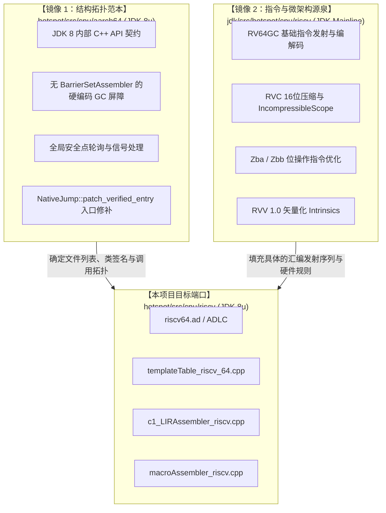

# 03 - 系统架构与子系统设计方案 (Architecture & Subsystems Design)

本文档定义了 OpenJDK 8u RISC-V Port 的整体微架构映射、核心子系统设计规范与关键代码拓扑。

---

## 一、“双镜像”（Dual-Mirror）移植策略

从工程方法论上，本项目采用精准的“双镜像”参照开发模型：



---

## 二、通用寄存器分配与 HotSpot 运行时约定

RISC-V 具备 32 个 64 位通用整数寄存器（`x0 ~ x31`）与 32 个浮点寄存器（`f0 ~ f31`）。在 HotSpot 运行时中，寄存器分配策略如下：

### 2.1 基础 ABI 约定（标准 RISC-V LP64D）
* `x0 (zero)`: 硬件硬连线常数 0；
* `x1 (ra)`: 返回地址寄存器（Return Address）；
* `x2 (sp)`: 栈指针（Stack Pointer），必须保持 16 字节对齐；
* `x8 (s0 / fp)`: 帧指针（Frame Pointer）；
* `x10 ~ x17 (a0 ~ a7)`: C/Java 调用实参寄存器与返回值（`a0, a1` 返回结果）；
* `x5 ~ x7, x28 ~ x31 (t0 ~ t6)`: 临时易失暂存寄存器（Caller-saved Scratch Registers）；
* `x9, x18 ~ x27 (s1 ~ s11)`: 被调用者保存寄存器（Callee-saved Registers）。

### 2.2 HotSpot 专用保留寄存器（Special Dedicated Registers）
为了实现极致的运行时吞吐，HotSpot 将部分被调用者保存寄存器锚定为专用指针：
* **`s10`（JavaThread* / `xthread`）**：全局常驻当前线程指针，消除通过 TLS 系统调用读取线程上下文的额外开销；
* **`s11`（Universe::narrow_oop_base / `xheapbase`）**：在开启压缩指针（`-XX:+UseCompressedOops`）时，常驻堆基址，用于快速解压对象引用；
* **解释器专用（Interpreter Execution）**：
  * `s9 (xmethod)`: 当前执行的 `Method*` 指针；
  * `s8 (xbcp)`: 字节码指针（Bytecode Pointer，PC 游标）；
  * `s7 (xlocals)`: 局部变量表基址指针；
  * `s6 (xdispatch)`: 字节码派发表（Dispatch Table）基址。

---

## 三、内存模型（RVWMO）与并发原子操作实现

RISC-V 采用弱内存模型 **RVWMO（RISC-V Weak Memory Ordering）**，其松散程度类似于 ARM，弱于 x86 的 TSO。

### 3.1 内存屏障（Memory Barriers）映射规则
在 [`orderAccess_linux_riscv.inline.hpp`](file:///Users/wujiahua/code/riscv-port-jdk8u) 中，基于 RISC-V `fence` 指令的掩码位映射 Java 内存屏障：
* **`loadload()`**: `__asm__ volatile ("fence r, r" : : : "memory");`
* **`storestore()`**: `__asm__ volatile ("fence w, w" : : : "memory");`
* **`loadstore()`**: `__asm__ volatile ("fence r, w" : : : "memory");`
* **`storeload()`**: `__asm__ volatile ("fence rw, rw" : : : "memory");`（全屏障，对应 Volatile 写后屏障）
* **`acquire()`**: `__asm__ volatile ("fence r, rw" : : : "memory");`
* **`release()`**: `__asm__ volatile ("fence rw, w" : : : "memory");`

### 3.2 并发原子操作（Atomic CAS / Fetch-and-Add）
在 [`atomic_linux_riscv.inline.hpp`](file:///Users/wujiahua/code/riscv-port-jdk8u) 中：
* 优先使用标准 **"A" 扩展指令**（Atomic Instructions）：
  * 原子加法：`amoadd.w` (32位) / `amoadd.d` (64位) 带 `.aqrl` 屏障；
  * 原子交换：`amoswap.w` / `amoswap.d`；
* 复杂 CAS（Compare-and-Swap）：使用 **LR/SC 循环（Load-Reserved / Store-Conditional）**：
  ```assembly
  1:  lr.d.aq    t0, (addr)
      bne        t0, expected, 2f
      sc.d.rl    t1, new_val, (addr)
      bnez       t1, 1b        # 争抢失败，重试
  2:  ...
  ```

---

## 四、安全点与异常恢复机制（Safepoints & Signals）

### 4.1 全局安全点轮询（Global Safepoint Page）
由于 JDK 8u 不支持 JEP 312 线程本地握手，系统采用单一全局轮询页：
* **JIT 编译代码在方法返回和回边循环处发射检测**：
  ```assembly
  # 读取全局安全点页，正常情况下命中缓存行，零损耗
  ld   t0, Address(os::get_polling_page())
  lwu  zero, 0(t0)
  ```
* **进入安全点时**：VMThread 调用 `mprotect(page, PROT_NONE)`，上述 `lwu` 触发硬件只读段错误 `SIGSEGV`。
* **信号处理（`os_linux_riscv.cpp`）**：
  * 在信号处理函数中比对故障地址是否等于 `os::get_polling_page()`；
  * 如果吻合，直接修补上下文结构体中的 PC 指针，将线程重定向至 `SharedRuntime::get_poll_stub()`，进入挂起队列。

---

## 五、三大垃圾回收器写屏障设计（PS, CMS, G1）

### 5.1 Parallel Scavenge (PS) / Serial GC 屏障
* 仅需卡表写后屏障（Card Table Post-barrier）。
* 当在堆中写入引用字段（`store [obj + offset], new_val`）后发射：
  ```assembly
  # store_addr 为被修改字段地址
  srli  t0, store_addr, 9             # CardTableModRefBS::card_shift (512字节/卡)
  add   t0, byte_map_base, t0         # 加上卡表虚拟基址
  sb    zero, 0(t0)                   # 标记卡为脏 (0)
  ```

### 5.2 CMS (Concurrent Mark Sweep) 屏障
* 主线 RISC-V 端口完全缺失 CMS 代码，本项目根据 AArch64 JDK 8u 规范从头移植。
* **Store-Check 优化屏障**：在并发标记阶段，为了避免多核反复写脏卡表导致总线风暴与 L1 缓存行乒乓，增加先读后写判断：
  ```assembly
  srli  t0, store_addr, 9
  add   t0, byte_map_base, t0
  lbu   t1, 0(t0)
  beqz  t1, 1f                        # 如果已经是 dirty (0)，直接跳过写入！
  sb    zero, 0(t0)
  1:
  ```

### 5.3 G1 GC 屏障（SATB 预写屏障 + 跨 Region 脏卡队列）
在 `macroAssembler_riscv.cpp` 中直接实现两个核心宏：
1. **G1 Pre-Barrier (SATB 预写屏障)**：
   * 在覆盖原引用前，读取旧值；
   * 检查 `JavaThread::_satb_mark_queue._active` 是否激活；
   * 若激活且旧值不为 null，将旧值存入线程局部 `satb_mark_queue` 缓冲区；
   * 若缓冲区满，跳转调用 `Runtime1::g1_pre_barrier_slow_id` 慢速 Stub 处理。
2. **G1 Post-Barrier (Dirty Card 队列屏障)**：
   * 跨 Region 检查：`xor(t0, store_addr, new_val); srli(t0, t0, HeapRegion::LogOfHRGrainBytes); beqz(t0, skip);`
   * 若跨 Region，计算卡地址并检查是否已在过滤缓存中；
   * 将脏卡地址追加至线程局部 `dirty_card_queue`，满时跳转慢速 Stub。

---

## 六、JIT 编译器与硬件指令集优化策略

### 6.1 RVC（16位压缩指令）并发修补安全防护
* **核心风险**：在 JDK 8u 中，`NativeJump::patch_verified_entry()` 仍会在运行时多线程并发覆盖方法入口。如果该指令因为前面的 16 位指令导致落在 `offset % 64 == 62` 的位置，一条 32 位的修改指令将跨越两个 64 字节缓存行，导致多核非原子写入抛出 `SIGILL`。
* **工程防线**：
  1. 所有 patchable 调用点和方法入口强制包裹在 `IncompressibleScope` 中；
  2. 关键补丁点前显式插入 `__ align(NativeInstruction::instruction_size)`（4 字节自然对齐），从数学上彻底绝除跨 64 字节缓存行缝隙的可能；
  3. 修补完成后成对调用 `cmodx_fence()` 发射 `fence.i`（Zifencei 扩展）冲刷硬件取指队列。

### 6.2 Zba 与 Zbb 位操作加速
* 利用 `sh1add`, `sh2add`, `sh3add`（Zba 扩展）将数组下标寻址与对象头部偏移计算压缩为单周期复合指令；
* 利用 `clz`, `ctz`, `cpop`（Zbb 扩展）直接映射 Java 的 `Long.numberOfLeadingZeros()`、`Integer.bitCount()` 为单条硬件指令，性能比软件分支查表提升一个数量级。

### 6.3 RVV 1.0 矢量化 Intrinsics
在 C2 编译期对热点运行时例程做向量加速：
* `StubRoutines` 中的基础数组拷贝（`arraycopy`）：利用动态 `vsetvli` 向量长度自适应批量搬运；
* `String.indexOf`、`String.compareTo`、`String.equals` 字符串向量匹配。
