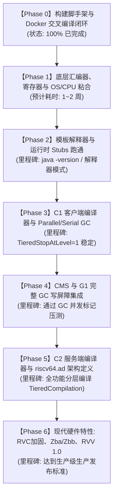

# 04 - 分阶段实施路线图与验收里程碑 (Roadmap & Milestones)

本文档制定了从底层汇编到 C2 编译器与全套 GC 支持的完整交付路径，共划分为 7 个关键迭代阶段。

---

## 一、阶段里程碑全景甘特图



---

## 二、各阶段详细任务与验收标准

### 【Phase 0：构建系统打桩与容器闭环】（已完成 100%）
* **目标**：在 Apple Silicon Mac 上搭建完整的 Docker 交叉编译与仿真环境，打通 autoconf 架构探测。
* **已交付物**：
  * [`docker/Dockerfile`](file:///Users/wujiahua/code/riscv-port-jdk8u/docker/Dockerfile) 与 6 个核心自动化工作流脚本；
  * [`common/autoconf/platform.m4`](file:///Users/wujiahua/code/riscv-port-jdk8u/common/autoconf/platform.m4) 注入 `riscv64` 探测；
  * [`common/autoconf/build-aux/config.sub`](file:///Users/wujiahua/code/riscv-port-jdk8u/common/autoconf/build-aux/config.sub) 解决 `riscv64-linux-gnu` 三元组识别；
  * [`hotspot/make/linux/platform_riscv64`](file:///Users/wujiahua/code/riscv-port-jdk8u/hotspot/make/linux/platform_riscv64) 与相关 makefile 骨架建立；
* **验收结果**：`./docker/configure.sh` 成功生成 Makefile，`./docker/make.sh hotspot` 精准进入源码依赖阶段。

---

### 【Phase 1：底层汇编器、寄存器与 OS/CPU 粘合】
* **核心目标**：建立 RISC-V 指令发射器与操作系统硬件线程粘合层。
* **具体任务**：
  1. 在 `hotspot/src/cpu/riscv/vm/` 建立：
     * `register_riscv.hpp/cpp`: 定义通用寄存器（`x0~x31`）与浮点寄存器（`f0~f31`）元数据；
     * `assembler_riscv.hpp/cpp`: 移植基础 RV64I/M/A/F/D 机器码发射与打包逻辑；
     * `macroAssembler_riscv.hpp/cpp`: 移植高频宏指令（如 `movptr`, `call_VM`, `safepoint_poll` 等）；
     * `vm_version_riscv.hpp/cpp`: 硬件能力探测与 JVM 参数联动（如 `UseRVC`, `UseZba`）；
  2. 在 `hotspot/src/os_cpu/linux_riscv/vm/` 建立：
     * `atomic_linux_riscv.inline.hpp`: 基于 LR/SC 与 AMO 指令的原子 CAS 实现；
     * `orderAccess_linux_riscv.inline.hpp`: 基于 `fence` 指令的内存屏障实现；
     * `os_linux_riscv.cpp`: Linux 信号处理（SIGSEGV, SIGBUS, SIGILL）与 `ucontext_t` PC 提取/修正。
* **验收标准**：
  * HotSpot 基础公共文件无编译报错；
  * 编写微型单元测试验证 `MacroAssembler` 发射的指令序列在 QEMU 下解码正确。

---

### 【Phase 2：模板解释器与运行时 Stubs（第一个里程碑）】
* **核心目标**：实现纯解释器模式（`-Xint`）下的完整运行，打通 Java 字节码执行闭环。
* **具体任务**：
  1. **运行时基础桩生成器**：
     * `stubGenerator_riscv.cpp`: 生成 `call_stub`（Java 调用 C++ 的进入桥梁）、`catch_exception_entry` 等；
     * `sharedRuntime_riscv.cpp`: 生成 Java/JNI 桥接例程与反优化桩；
  2. **模板解释器核心**：
     * `templateTable_riscv_64.cpp`: 逐一实现 200+ 个 Java 字节码指令的汇编发射模板；
     * `templateInterpreter_riscv.cpp`: 栈帧建立（`enter`/`leave`）、方法分派与局部变量管理；
  3. **堆与内存基类配置**：启用 Serial GC 与基础堆分配。
* **验收标准（Milestone 1）**：
  * 在 QEMU 仿真环境下，成功执行：
    ```bash
    ./docker/qemu-java.sh -Xint -version
    ```
  * 成功执行基础 `HelloWorld.class` 并正确打印输出。

---

### 【Phase 3：C1 客户端编译器与 Parallel GC】
* **核心目标**：打通一阶段 JIT 编译能力，大幅提升虚拟机热点循环执行性能。
* **具体任务**：
  1. 移植 C1 线性扫描寄存器分配器与 LIR 汇编器：
     * `c1_LIRAssembler_riscv.cpp`
     * `c1_LIRGenerator_riscv.cpp`
     * `c1_FrameMap_riscv.cpp`
     * `c1_Runtime1_riscv.cpp`
  2. 实现 Parallel Scavenge（PS）垃圾回收器的卡表写屏障；
  3. 支持分层编译第 1 阶段（`-XX:TieredStopAtLevel=1`）。
* **验收标准（Milestone 2）**：
  * 开启 JIT 编译执行复杂数学计算与微基准，能观测到 C1 动态生成的本地机器码；
  * 在 ParallelGC 下完成长时间大对象分配循环，无内存泄漏与死锁。

---

### 【Phase 4：CMS 与 G1 垃圾回收器写屏障集成】
* **核心目标**：补齐现代企业级生产运行必备的低延迟与服务端垃圾回收能力。
* **具体任务**：
  1. **CMS（Concurrent Mark Sweep）支持**：
     * 在 `macroAssembler_riscv.cpp` 中实现 CMS 的 `store-check` 并发卡标记屏障；
     * 编写 jtreg 测试跑通 `-XX:+UseConcMarkSweepGC`；
  2. **G1 GC 支持**：
     * 移植 G1 SATB（Snapshot-At-The-Beginning）旧值拦截预写屏障；
     * 移植 G1 Dirty Card 跨 Region 脏卡队列写后屏障；
     * 打通 C1/运行时中的 G1 慢速分配 Stub。
* **验收标准（Milestone 3）**：
  * 执行 `jtreg test/hotspot/jtreg:gc/g1` 与 `test/hotspot/jtreg:gc/cms` 核心用例全部通过。

---

### 【Phase 5：C2 服务端编译器与 riscv64.ad 架构定义】
* **核心目标**：实现终极 JIT 编译器 C2（Server Compiler），达到与 x86-64 / AArch64 比肩的峰值运行性能。
* **具体任务**：
  1. 构建巨型架构描述文件 `hotspot/src/cpu/riscv/vm/riscv64.ad`；
  2. 裁剪现代 JDK 引入的非 JDK 8 MachNode，适配 JDK 8 的 ADLC 编译器；
  3. 定义完备的指令匹配规则（Instruction Match Rules）、操作数约束（Operands）、寄存器掩码（RegMask）与管道调度（Pipeline Models）；
  4. 实现 C2 级别的 G1/CMS 屏障内联匹配。
* **验收标准（Milestone 4）**：
  * 成功启用完整的分层编译机制（`-XX:+TieredCompilation`）；
  * 跑通复杂企业级框架（Spring Boot 启动与负载运行）。

---

### 【Phase 6：现代硬件扩展加速与全套测试加固】
* **核心目标**：全面对齐现代 RISC-V 硬件新特性，完成工业级质量验收。
* **具体任务**：
  1. **RVC（16位压缩指令）加固**：
     * 验证所有修补点强制 4 字节自然对齐；
     * 在长时间并发反优化测试中保证 0 次 `SIGILL`；
  2. **位操作扩展（Zba/Zbb）**：
     * 打通 `clz`, `ctz`, `cpop`, `sh1add` 等高效指令映射；
  3. **矢量化扩展（RVV 1.0）**：
     * 实现基础 `arraycopy` 和字符串 Intrinsics 向量化加速。
* **验收标准（Final Milestone）**：
  * **jtreg 全量回归**：`test/hotspot/jtreg` 核心用例通过率 $\ge 99\%$；
  * **权威基准测试**：成功运行 SPECjvm2008 与 DaCapo 基准套件，性能曲线平稳。

---

## 三、风险控制与回退预案（Risk Management）

1. **RVC 并发修补风险**：
   * *预案*：JVM 初始调试与移植阶段，默认禁用 RVC（`-XX:-UseRVC`）。待 C1/C2 与反优化稳定性验证完毕后，再行开启。
2. **QEMU 用户态多线程内存模型仿真差异**：
   * *预案*：QEMU 默认在 x86/arm64 宿主上可能提供强于 RISC-V RVWMO 的内存序，隐藏部分漏掉的 `fence` 指令。为此在 Phase 4 之后，定期安排在真实的物理 RISC-V 开发板（如 Milk-V Pioneer 64核服务器、SpacemiT K1）上跑多线程并发压力测试，严查内存屏障缺失缺陷。
