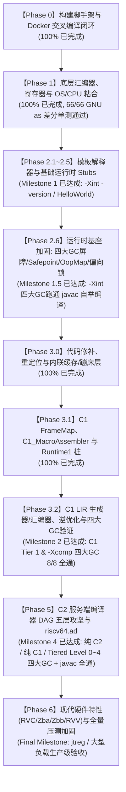
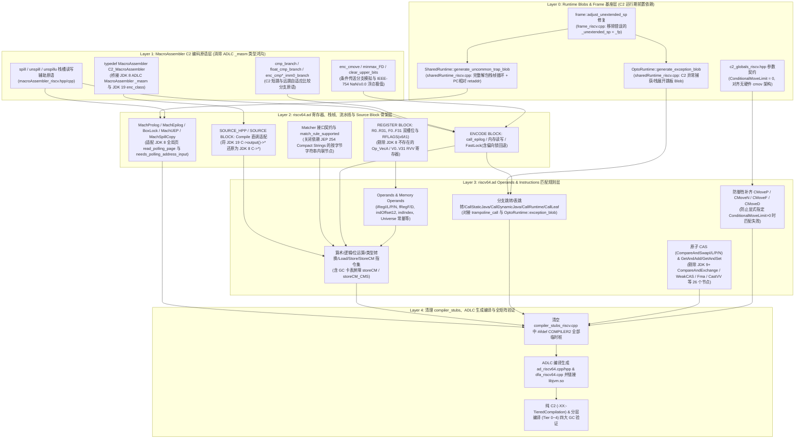

# 04 - 分阶段实施路线图与验收里程碑 (Roadmap & Milestones)

本文档制定了从底层汇编到 C2 编译器与全套 GC 支持的完整交付路径。随着工程实践深入，路线图根据真实踩坑与架构演进进行了动态调优，形成了一套可复用的 **“三位一体”跨代移植工程路线图**。

---

## 一、核心工程原则：“三位一体”移植范式与路线演进思考

在将 RISC-V 64-bit（RV64GC）移植到 OpenJDK 8u 的过程中，由于上游官方 RISC-V 端口直到 JDK 19（JEP 422）才正式合入主线，我们面临整整 **11 个大版本（JDK 8 $\leftrightarrow$ JDK 19）的虚拟机底层架构鸿沟**。为此，本项目确立了三大核心工程原则：

1. **架构与规范之锚（What & Why）——严格对齐本仓 JDK 1.8 AArch64 端口**：
   - 在类继承体系、函数签名、运行时协议（如全局单页 Safepoint 轮询、`OopMap` 栈回溯、偏向锁状态机、内联 `MacroAssembler` GC 写屏障、`CompiledStaticCall` 静态调用桩结构）上，100% 遵循 [`hotspot/src/cpu/aarch64/vm/`](file:///Users/wujiahua/code/riscv-port-jdk8u/hotspot/src/cpu/aarch64/vm/) 的设计。
2. **RISC-V 指令与编码之源（How in RISC-V）——严格参考 JDK 19 (`jdk-19-ga`) RISC-V 源码**：
   - 具体如何用 RISC-V 寄存器约定（`xthread=x23`, `xheapbase=x27`, `xmethod=x31`, `esp=x20`）、RVWMO 内存序（`fence` / `lr.d.aqrl` / `sc.d.rl`）、48 位地址定长加载（`movptr` 6 指令序列）、C1 LIR 生成器与 C2 `riscv64.ad` 规则来实现，直接参考本地 [`/Users/wujiahua/code/jdk19/src/hotspot/cpu/riscv/`](file:///Users/wujiahua/code/jdk19/src/hotspot/cpu/riscv/)（不看 JDK 19 之后演进过大的代码）。
3. **基座先行、小步快跑（Bottom-Up Hardening Before JIT）——关键路线调优**：
   - **原始路线图的误区**：原计划在解释器仅跑通 `-Xint -version` 和 Serial GC 后就立即启动 C1 编译器，将偏向锁、G1/CMS 写屏障留到 Phase 4。
   - **工程实践后的关键修正（新增 Phase 2.6 与 Phase 3.0）**：
     - Safepoint 栈回溯（`OopMap`）、偏向锁/轻量级栈锁 CAS、四大 GC（Serial/Parallel/CMS/G1）写屏障是**比 JIT 编译器更底层的运行时基座**。如果解释器与 Stubs 层面的 GC 屏障或栈回溯存在隐患，一旦叠加 C1/C2 动态机器码，排查难度将呈指数级上升。因此我们将四大 GC 屏障、全局 Safepoint、`OopMap` 与偏向锁全部前移至 **Phase 2.6**，并在 `-Xint` 下跑通 RISC-V `javac` 自举编译。
     - 在进入 C1 之前，必须先打通 **Phase 3.0（代码修补 `nativeInst`、重定位 `relocInfo`、内联缓存 `CompiledIC` 与远跳蹦床 `Trampoline`）**，解决“编译期 0 值占位发射 vs 运行期 48 位地址定长指令流回填”的架构鸿沟。

---

## 二、阶段里程碑全景图与真实代码依赖 DAG（Dependency DAG）

### 1. 路线图反思与纠偏：从“主观功能划分”走向“真实代码依赖 DAG”

在推进到 C1 竣工并切入 C2 编译器（Phase 5）时，我们结合本仓 **JDK 1.8 真实代码架构**（[`hotspot/src/share/vm/opto/`](file:///Users/wujiahua/code/riscv-port-jdk8u/hotspot/src/share/vm/opto/)、[`adlc/`](file:///Users/wujiahua/code/riscv-port-jdk8u/hotspot/src/share/vm/adlc/)、[`aarch64.ad`](file:///Users/wujiahua/code/riscv-port-jdk8u/hotspot/src/cpu/aarch64/vm/aarch64.ad)）与 **JDK 19 具体实现**（[`/Users/wujiahua/code/jdk19/src/hotspot/cpu/riscv/riscv.ad`](file:///Users/wujiahua/code/jdk19/src/hotspot/cpu/riscv/riscv.ad)），对先前的理论路线图进行了深刻反思，纠正了两大主观误区：

* **纠偏 1（关于 GC 屏障在三大执行引擎中的真实架构位置）**：
  * 先前路线图主观地将“CMS 与 G1 写屏障”单独列为夹在 C1 与 C2 之间的 Phase 4，并以为 C2 也需要在 `riscv64.ad` 中手写一套 G1 SATB / Dirty Card 汇编屏障。
  * **代码真相**：
    1. 在解释器与 Stubs 层（Phase 2.6）以及 C1 LIR 层（Phase 3.2），GC 屏障确实是平台相关的汇编逻辑（[`MacroAssembler::g1_write_barrier_pre/post`](file:///Users/wujiahua/code/riscv-port-jdk8u/hotspot/src/cpu/riscv/vm/macroAssembler_riscv.cpp) 与 [`G1Pre/PostBarrierStub`](file:///Users/wujiahua/code/riscv-port-jdk8u/hotspot/src/cpu/riscv/vm/c1_CodeStubs_riscv.cpp)），且我们已在 Phase 2.6 与 Phase 3.2 中 **100% 实现了四大 GC（Serial / Parallel / CMS / G1）在解释器与 C1 下的写屏障并验证通过**！
    2. 而在 **JDK 8u 的 C2 编译器**（以及 JEP 475 之前的 JDK 19）中，G1 SATB 预写屏障、G1 Dirty Card 写后屏障与 CardTable 写后屏障是在**平台无关的 Ideal Graph 阶段**（[`GraphKit::g1_write_barrier_pre/post`](file:///Users/wujiahua/code/riscv-port-jdk8u/hotspot/src/share/vm/opto/graphKit.cpp#L3775-L4070)、`write_barrier_post`）直接展开为基础 Ideal 节点的（`LoadP`, `LoadB`, `StoreB`, `StoreCM`, `If`, `CallLeafNoFP`, `ThreadLocal`, `CastP2X`, `URShiftX`）！
    3. 因此，`riscv64.ad` 根本不需要手写 G1 屏障汇编，它对 GC 屏障唯一的专属节点依赖是匹配 `Op_StoreCM`（即 `storeCM` 与 `storeCM_CMS` 两条规则）！
* **纠偏 2（关于 C2 编译器的真实前置依赖）**：
  * 先前路线图以为 C2 仅仅是编写 `riscv64.ad`。
  * **代码真相**：C2 生成的编译方法在运行期重度依赖两个此前仅留了空桩/假桩的底层 Runtime Blob——**`OptoRuntime::generate_exception_blob()`** 与 **`SharedRuntime::generate_uncommon_trap_blob()`**，且在代码发射层面临 **JDK 8 ADLC 硬编码生成 `MacroAssembler _masm(&cbuf)` vs JDK 19 `C2_MacroAssembler`**、**`Compile` vs `PhaseOutput` API 拆分**、**RISC-V 无硬件条件传送指令下的 `ConditionalMoveLimit=0` 约束** 等 8 大跨代架构鸿沟。

### 2. 全周期里程碑演进图

### 3. Phase 5（C2 服务端编译器）五层真实代码依赖 DAG

---

## 三、各阶段详细任务、架构鸿沟与验收标准

### 【Phase 0：构建系统打桩与容器闭环】（已完成 100%）
* **目标**：在 Apple Silicon Mac 上搭建完整的 Docker 交叉编译与仿真环境，打通 autoconf 架构探测。
* **已交付物**：
  * [`docker/Dockerfile`](file:///Users/wujiahua/code/riscv-port-jdk8u/docker/Dockerfile) 与 6 个核心自动化工作流脚本；
  * [`common/autoconf/platform.m4`](file:///Users/wujiahua/code/riscv-port-jdk8u/common/autoconf/platform.m4) 注入 `riscv64` 探测；
  * [`common/autoconf/build-aux/config.sub`](file:///Users/wujiahua/code/riscv-port-jdk8u/common/autoconf/build-aux/config.sub) 解决 `riscv64-linux-gnu` 三元组识别；
  * [`hotspot/make/linux/platform_riscv64`](file:///Users/wujiahua/code/riscv-port-jdk8u/hotspot/make/linux/platform_riscv64) 与相关 makefile 骨架建立；
* **验收结果**：`./docker/configure.sh` 成功生成 Makefile，`./docker/make.sh hotspot` 精准进入源码依赖阶段。

---

### 【Phase 1：底层汇编器、寄存器与 OS/CPU 粘合】（已完成 100%）
* **核心目标**：建立 RISC-V 指令发射器与操作系统硬件线程粘合层。
* **已交付物**：
  1. 在 [`hotspot/src/cpu/riscv/vm/`](file:///Users/wujiahua/code/riscv-port-jdk8u/hotspot/src/cpu/riscv/vm/) 建立：
     * [`register_riscv.hpp`](file:///Users/wujiahua/code/riscv-port-jdk8u/hotspot/src/cpu/riscv/vm/register_riscv.hpp) / [`register_riscv.cpp`](file:///Users/wujiahua/code/riscv-port-jdk8u/hotspot/src/cpu/riscv/vm/register_riscv.cpp)：定义通用寄存器（`x0~x31`）与浮点寄存器（`f0~f31`）元数据；
     * [`assembler_riscv.hpp`](file:///Users/wujiahua/code/riscv-port-jdk8u/hotspot/src/cpu/riscv/vm/assembler_riscv.hpp) / [`assembler_riscv.cpp`](file:///Users/wujiahua/code/riscv-port-jdk8u/hotspot/src/cpu/riscv/vm/assembler_riscv.cpp)：移植基础 RV64I/M/A/F/D 机器码发射与打包逻辑；
     * [`macroAssembler_riscv.hpp`](file:///Users/wujiahua/code/riscv-port-jdk8u/hotspot/src/cpu/riscv/vm/macroAssembler_riscv.hpp) / [`macroAssembler_riscv.cpp`](file:///Users/wujiahua/code/riscv-port-jdk8u/hotspot/src/cpu/riscv/vm/macroAssembler_riscv.cpp)：移植高频宏指令；
     * [`vm_version_riscv.hpp`](file:///Users/wujiahua/code/riscv-port-jdk8u/hotspot/src/cpu/riscv/vm/vm_version_riscv.hpp) / [`vm_version_riscv.cpp`](file:///Users/wujiahua/code/riscv-port-jdk8u/hotspot/src/cpu/riscv/vm/vm_version_riscv.cpp)：硬件能力探测；
  2. 在 [`hotspot/src/os_cpu/linux_riscv/vm/`](file:///Users/wujiahua/code/riscv-port-jdk8u/hotspot/src/os_cpu/linux_riscv/vm/) 建立：
     * [`atomic_linux_riscv.inline.hpp`](file:///Users/wujiahua/code/riscv-port-jdk8u/hotspot/src/os_cpu/linux_riscv/vm/atomic_linux_riscv.inline.hpp)：基于 AMO 与 LR/SC 指令的原子操作实现；
     * [`orderAccess_linux_riscv.inline.hpp`](file:///Users/wujiahua/code/riscv-port-jdk8u/hotspot/src/os_cpu/linux_riscv/vm/orderAccess_linux_riscv.inline.hpp)：基于 `fence` 指令的 RVWMO 内存屏障实现；
     * [`os_linux_riscv.cpp`](file:///Users/wujiahua/code/riscv-port-jdk8u/hotspot/src/os_cpu/linux_riscv/vm/os_linux_riscv.cpp)：Linux 信号处理（SIGSEGV, SIGBUS, SIGILL）与 `ucontext_t` PC 提取/修正。
* **验收结果**：66/66 项指令编码与 GNU `riscv64-linux-gnu-as` 差分比对 100% 一致，`libjvm.so` 首次成功编译链接。

---

### 【Phase 2：模板解释器、运行时 Stubs 与底层基座加固】（已完成 100%）

#### 1. Phase 2.1 ~ 2.5：模板解释器与字节码执行闭环（Milestone 1 已达成，Commit `a14d5214d0`）
* **已交付物**：
  * [`stubGenerator_riscv.cpp`](file:///Users/wujiahua/code/riscv-port-jdk8u/hotspot/src/cpu/riscv/vm/stubGenerator_riscv.cpp)：`call_stub`、异常处理桩、`SafeFetch`、全类型 `arraycopy` 桩；
  * [`sharedRuntime_riscv.cpp`](file:///Users/wujiahua/code/riscv-port-jdk8u/hotspot/src/cpu/riscv/vm/sharedRuntime_riscv.cpp)：I2C/C2I 适配器、JNI Native Wrapper、Deopt / Uncommon Trap / Safepoint Handler Blob；
  * [`templateTable_riscv.cpp`](file:///Users/wujiahua/code/riscv-port-jdk8u/hotspot/src/cpu/riscv/vm/templateTable_riscv.cpp) & [`templateInterpreter_riscv.cpp`](file:///Users/wujiahua/code/riscv-port-jdk8u/hotspot/src/cpu/riscv/vm/templateInterpreter_riscv.cpp)：200+ 个 Java 字节码模板与各类方法入口。
* **跨越的核心架构鸿沟**：
  * `sp`（16 字节对齐硬件栈）与 `esp`（8 字节槽位 Java 表达式栈）双栈解耦；
  * `call_VM_leaf_base` 对 `xmethod (t6/x31)` 调用者保存寄存器的跨 C++ 调用保护；
  * C++ 虚表调用中的 `vtable_index` 字节偏移 vs 机器字索引换算。

#### 2. Phase 2.6：Safepoint、OopMap、偏向锁与四大 GC 屏障基座加固（Milestone 1.5 已达成，Commit `32e0e50642`）
* **为什么在 C1 之前插入本阶段**：
  * JDK 19 移除了偏向锁（JEP 374）、改用了线程局部安全点轮询（JEP 312）并引入了 `BarrierSetAssembler`（JEP 304），而 JDK 8u 默认开启偏向锁、使用全局单页 Safepoint 轮询，且将 G1/CardTable 屏障直接内联在 `MacroAssembler` 中。必须在纯解释器下先把这些基座彻底跑通。
* **已交付物与跨越的架构鸿沟**：
  * **鸿沟 1（JDK 15 移除偏向锁 vs JDK 8u 默认开启偏向锁）**：从 JDK 8u AArch64 逆向移植 `biased_locking_enter/exit` 与 `InterpreterMacroAssembler::lock_object/unlock_object` 轻量级栈锁 CAS 快路径，解决 4 秒启动延迟后触发 `ObjectSynchronizer::fast_exit` 断言崩溃问题；
  * **鸿沟 2（JDK 11 `BarrierSetAssembler` vs JDK 8u 内联屏障）**：在 [`macroAssembler_riscv.cpp`](file:///Users/wujiahua/code/riscv-port-jdk8u/hotspot/src/cpu/riscv/vm/macroAssembler_riscv.cpp) 与 [`stubGenerator_riscv.cpp`](file:///Users/wujiahua/code/riscv-port-jdk8u/hotspot/src/cpu/riscv/vm/stubGenerator_riscv.cpp) 中完备实现 Serial、Parallel、CMS、G1 四大 GC 的字段写屏障与 `oop_arraycopy` 批量写屏障；
  * **鸿沟 3（Safepoint 栈回溯与 `OopMap` 粒度）**：修复 [`frame_riscv.cpp`](file:///Users/wujiahua/code/riscv-port-jdk8u/hotspot/src/cpu/riscv/vm/frame_riscv.cpp) 中 `saved_fp` 偏移（`sender_sp - 2`）以及 [`sharedRuntime_riscv.cpp`](file:///Users/wujiahua/code/riscv-port-jdk8u/hotspot/src/cpu/riscv/vm/sharedRuntime_riscv.cpp) 中 `OopMap` 的 4 字节（`BytesPerInt`）VMReg 槽位单位；
  * **验收结果**：在 `-Xint` 下，四大 GC（Serial / Parallel / CMS / G1）+ 立即偏向锁模式 100% 跑通 [`ComprehensiveTest.java`](file:///Users/wujiahua/code/riscv-port-jdk8u/ComprehensiveTest.java) 及 **RISC-V `javac` 自举编译**！

---

### 【Phase 3：代码修补重定位层与 C1 客户端编译器】（已完成 100%，Milestone 2 达成）

为了确保工程可控、步步为营，Phase 3 拆分为 3 个严格递进的子阶段：

#### 【Step 3.0：代码修补、重定位与内联缓存/蹦床层（JIT 前置基座）】（已完成 100%，Commit `70797efb1d`）
* **核心目标**：打通 JIT 编译代码生成、安装（`CodeBuffer::copy_code_to`）、重定位（`Relocation`）、内联缓存（`CompiledIC` / `icBuffer`）与远距离调用蹦床（`NativeCallTrampolineStub`）的全链路机器码修补能力。
* **已交付物**：
  * [`hotspot/src/cpu/riscv/vm/nativeInst_riscv.hpp`](file:///Users/wujiahua/code/riscv-port-jdk8u/hotspot/src/cpu/riscv/vm/nativeInst_riscv.hpp) & [`nativeInst_riscv.cpp`](file:///Users/wujiahua/code/riscv-port-jdk8u/hotspot/src/cpu/riscv/vm/nativeInst_riscv.cpp)
  * [`hotspot/src/cpu/riscv/vm/relocInfo_riscv.cpp`](file:///Users/wujiahua/code/riscv-port-jdk8u/hotspot/src/cpu/riscv/vm/relocInfo_riscv.cpp)
  * [`hotspot/src/cpu/riscv/vm/compiledIC_riscv.cpp`](file:///Users/wujiahua/code/riscv-port-jdk8u/hotspot/src/cpu/riscv/vm/compiledIC_riscv.cpp) & [`icBuffer_riscv.cpp`](file:///Users/wujiahua/code/riscv-port-jdk8u/hotspot/src/cpu/riscv/vm/icBuffer_riscv.cpp)
  * [`hotspot/src/cpu/riscv/vm/assembler_riscv.hpp`](file:///Users/wujiahua/code/riscv-port-jdk8u/hotspot/src/cpu/riscv/vm/assembler_riscv.hpp) & [`macroAssembler_riscv.hpp`](file:///Users/wujiahua/code/riscv-port-jdk8u/hotspot/src/cpu/riscv/vm/macroAssembler_riscv.hpp) / [`macroAssembler_riscv.cpp`](file:///Users/wujiahua/code/riscv-port-jdk8u/hotspot/src/cpu/riscv/vm/macroAssembler_riscv.cpp)
* **跨越的核心架构鸿沟**：
  * **定长可修补 `movptr`（固定 6 条指令 24 字节）vs 变长立即数加载 `li`（1~6 条指令）**：JIT 编译期常发射 `mov_metadata(reg, NULL)` 或 `movoop(reg, jobject)` 并在 `CodeSection` 记录重定位项，待安装或运行期通过 `NativeMovConstReg::set_data` / `Relocation::pd_set_data_value` 回填真实 48 位地址。若 `movptr(..., 0)` 收缩为单条 `mv reg, zr`，运行期按 24 字节回填将直接摧毁后续 5 条指令！
  * **`mov_metadata` / `movoop` 重定位项注册**：确保每次发射可修补元数据/对象引用时向 `code_section()->relocate(pc(), rspec)` 注册重定位记录，并支持压缩指针下的 `li32`（`lui + addiw` 8 字节）`patch_oop`。
  * **RISC-V `jal` $\pm 1\text{MB}$ 跳转范围限制与 `Trampoline` 蹦床桩**：AArch64 的 `bl` 拥有 $\pm 128\text{MB}$ 寻址范围，而 RISC-V 的单指令 `jal` 仅有 $\pm 1\text{MB}$ 范围！在默认最大 240MB 的 CodeCache 中，JIT 方法间调用与 Runtime 调用必须通过 `trampoline_call` + `NativeCallTrampolineStub`（`auipc + ld + jr + 64-bit target`）实现原子可修补远跳。

#### 【Step 3.1：C1 寄存器映射、宏汇编与 Runtime1 运行时桩】（已完成 100%）
* **核心目标**：建立 C1 编译器的栈帧布局、物理寄存器池分配规则、C1 专用宏汇编与 `Runtime1` 慢速路径 Stubs。
* **已交付物**：
  1. [`c1_FrameMap_riscv.hpp`](file:///Users/wujiahua/code/riscv-port-jdk8u/hotspot/src/cpu/riscv/vm/c1_FrameMap_riscv.hpp) / [`c1_FrameMap_riscv.cpp`](file:///Users/wujiahua/code/riscv-port-jdk8u/hotspot/src/cpu/riscv/vm/c1_FrameMap_riscv.cpp)：映射 22 个可分配通用寄存器（`rnr 0..21`）与 32 个浮点物理寄存器的 `LIR_Opr`，严格隔离 10 个保留寄存器（`xheapbase`, `xthread`, `fp`, `zr`, `ra`, `sp`, `gp`, `tp`, `t0`, `t1` 位于 `rnr 22..31`）；
  2. [`c1_MacroAssembler_riscv.hpp`](file:///Users/wujiahua/code/riscv-port-jdk8u/hotspot/src/cpu/riscv/vm/c1_MacroAssembler_riscv.hpp) / [`c1_MacroAssembler_riscv.cpp`](file:///Users/wujiahua/code/riscv-port-jdk8u/hotspot/src/cpu/riscv/vm/c1_MacroAssembler_riscv.cpp)：实现 C1 内联缓存校验 `inline_cache_check`、编译帧建立 `build_frame`、快速对象/数组分配 `allocate_object` / `allocate_array`、C1 快速锁 `lock_object` / `unlock_object`（集成偏向锁与 CAS 轻量级锁）；
  3. [`c1_CodeStubs_riscv.cpp`](file:///Users/wujiahua/code/riscv-port-jdk8u/hotspot/src/cpu/riscv/vm/c1_CodeStubs_riscv.cpp)：实现转换、范围检查、除零异常、`NewInstance`、`NewTypeArray`、`NewObjectArray`、`G1PreBarrierStub`、`G1PostBarrierStub`、`PatchingStub`、`MonitorEnter/Exit` 等全部 C1 尾置慢速桩；
  4. [`c1_Runtime1_riscv.cpp`](file:///Users/wujiahua/code/riscv-port-jdk8u/hotspot/src/cpu/riscv/vm/c1_Runtime1_riscv.cpp)：生成全部 C1 `Runtime1` 存根（异常展开、对象分配、数组分配、卡表/G1 慢速屏障、反优化与逆优化式代码修补 `patch_code_riscv`）。
* **跨越的核心架构鸿沟**：
  * **JDK 19 `#ifdef DEOPTIMIZE_WHEN_PATCHING` vs JDK 8u `#ifndef TARGET_ARCH_aarch64`**：在 [`c1_Runtime1.hpp`](file:///Users/wujiahua/code/riscv-port-jdk8u/hotspot/src/share/vm/c1/c1_Runtime1.hpp) / [`c1_Runtime1.cpp`](file:///Users/wujiahua/code/riscv-port-jdk8u/hotspot/src/share/vm/c1/c1_Runtime1.cpp) 中将 `TARGET_ARCH_riscv` 纳入与 AArch64 相同的逆优化修补机制（`Runtime1::patch_code_riscv`），规避 RVWMO 弱内存序下跨核原地拷贝 24 字节指令流的撕裂风险；
  * **RISC-V `StubFrame` 顶部 `fp` vs AArch64 底部 `rfp` 偏移差**：精确对齐 `StubFrame::load_argument`（`[fp + offset*8]`）与异常/修补返回地址槽位（`[fp - 8]`），并闭合 `save_live_registers` 中 27 个整数寄存器的奇数对齐填充字与 `OopMap` / `restore_live_registers_except_r10` 的三方契约；
  * **JDK 8u vs JDK 19 `CodeStubs` 契约适配**：适配双参数 `RangeCheckStub`、无参 `DeoptimizeStub`、多态 `CounterOverflowStub::_method` 以及 JEP 304 之前的内联 `G1Pre/PostBarrierStub`。

#### 【Step 3.2：C1 LIR 生成器与 LIR 汇编器（Milestone 2 已达成）】
* **核心目标**：打通 HIR $\rightarrow$ LIR $\rightarrow$ RISC-V 机器码完整编译流水线与逆优化（Deoptimization）闭环。
* **已交付物**：
  1. [`c1_LIRGenerator_riscv.cpp`](file:///Users/wujiahua/code/riscv-port-jdk8u/hotspot/src/cpu/riscv/vm/c1_LIRGenerator_riscv.cpp)：将平台无关 HIR 节点平铺为 RISC-V LIR 指令序列（含内置函数 Intrinsics、CAS、比较分支、算术运算与四大 GC 写屏障调用）；
  2. [`c1_LIRAssembler_riscv.cpp`](file:///Users/wujiahua/code/riscv-port-jdk8u/hotspot/src/cpu/riscv/vm/c1_LIRAssembler_riscv.cpp) & [`c1_LinearScan_riscv.hpp`](file:///Users/wujiahua/code/riscv-port-jdk8u/hotspot/src/cpu/riscv/vm/c1_LinearScan_riscv.hpp)：将 LIR 指令发射为 RISC-V 机器码（含方法序言/尾声、OSR 栈帧迁移、异常/反优化 Handler、Safepoint 轮询点、常量池加载与 `trampoline_call`）；
  3. [`methodHandles_riscv.hpp`](file:///Users/wujiahua/code/riscv-port-jdk8u/hotspot/src/cpu/riscv/vm/methodHandles_riscv.hpp) / [`methodHandles_riscv.cpp`](file:///Users/wujiahua/code/riscv-port-jdk8u/hotspot/src/cpu/riscv/vm/methodHandles_riscv.cpp)：实现 JSR 292 `MethodHandles` 适配器生成与 `jump_to_lambda_form`；
  4. 从 [`compiler_stubs_riscv.cpp`](file:///Users/wujiahua/code/riscv-port-jdk8u/hotspot/src/cpu/riscv/vm/compiler_stubs_riscv.cpp) 移除全部 C1 占位桩，仅保留 C2 Matcher 桩。
* **跨越的核心架构鸿沟**：
  * **C++ 基类 `CodeBlob` 构造期虚表（`vptr`）陷阱**：修复 [`nativeInst_riscv.cpp`](file:///Users/wujiahua/code/riscv-port-jdk8u/hotspot/src/cpu/riscv/vm/nativeInst_riscv.cpp) `NativeCall::get_trampoline()` 在 `CodeBlob` 构造期调用 `code->is_nmethod()` 恒返回 `false` 导致远跳保留 `jal ra, 0` 自跳死循环的陷阱；
  * **`NativeFenceI` 动态长度与 JDK 8u C1 `build_frame` 帧大小契约**：对齐 `UseConservativeFence` 下的 8 字节 `ifence()` 长度，并在 `C1_MacroAssembler::build_frame` / `remove_frame` 中补齐 JDK 8u `initial_frame_size_in_bytes()` 扣除的 `2 * wordSize`（16 字节 `fp/ra`）；
  * **`DeoptimizationBlob` 临时 `CodeBuffer` 被 `I2C/C2I adapters` 复用引发的逆优化栈帧误判**：将 `set_last_Java_frame` 与 `MacroAssembler::la(Register, const address)` 修复为 PC 相对的 `auipc + addi`，并将 C 栈上生成代码后裸 `memcpy` 的 `SignatureHandlerGenerator` 显式包装为 `ExternalAddress`；
  * **AArch64（48 位无符号 `movz/movk`）vs RISC-V（47 位无符号 / `-1` 有符号 `lui/addi`）在 `Universe::non_oop_word()` 上的编码鸿沟**：将 `os::non_memory_address_word()` 对齐为 `(char*)-1`，修复 GC Safepoint 扫描 Clean `CompiledIC` 时第 48 位借位翻转（`0xffffefffffffffff`）引发的断言崩溃。
* **验收结果（Milestone 2 达成）**：
  * 开启 `-XX:+TieredCompilation -XX:TieredStopAtLevel=1` 及 `-Xcomp -XX:TieredStopAtLevel=1` 成功运行 `-version`、`Hello` 与 [`ComprehensiveTest`](file:///Users/wujiahua/code/riscv-port-jdk8u/ComprehensiveTest.java)（包含 5 次 C1 逆优化打包/解包与 `System.gc()` Safepoint 扫描）；
  * 在四大 GC（Serial / Parallel / CMS / G1）下均 100% 通过 C1 Tier 1 与 `-Xcomp` 验证！

---

### 【Phase 5：C2 服务端编译器 DAG 五层攻坚与 riscv64.ad 架构定义】（已完成 100%，Milestone 4 达成）
* **核心目标**：基于真实代码依赖 DAG（Layer 0 ~ Layer 4），实现终极 JIT 编译器 C2（Server Compiler），打通完整分层编译（Tier 0 ~ Tier 4）与纯 C2 编译模式。
* **五层递进实施路径与 14 大跨代/跨层架构鸿沟跨越**：
  1. **Layer 0（Runtime Blobs、Frame 与跨层调用桩基座层）**：
     - 修复 [`frame_riscv.cpp`](file:///Users/wujiahua/code/riscv-port-jdk8u/hotspot/src/cpu/riscv/vm/frame_riscv.cpp) `frame::adjust_unextended_sp()`（对齐 JDK 19 RISC-V：MethodHandle 调用不修改 `sp` 且不保存在 `fp` 中，移除错误的 `_unextended_sp = _fp`）；
     - 在 [`sharedRuntime_riscv.cpp`](file:///Users/wujiahua/code/riscv-port-jdk8u/hotspot/src/cpu/riscv/vm/sharedRuntime_riscv.cpp) 完整实现 `SharedRuntime::generate_uncommon_trap_blob()`（适配 JDK 8 双参数 `Deoptimization::uncommon_trap(thread, trap_request)` + PC 相对 `retaddr` + 多帧解包循环 + 补齐调用者保存的 `xthread` 恢复 `__ ld(xthread, Address(sp, RegisterSaver::xthread_offset_in_bytes()))`）；
     - 在 [`sharedRuntime_riscv.cpp`](file:///Users/wujiahua/code/riscv-port-jdk8u/hotspot/src/cpu/riscv/vm/sharedRuntime_riscv.cpp) 完整实现 `OptoRuntime::generate_exception_blob()`（解决 `HandlerImpl::emit_exception_handler` 对 `OptoRuntime::exception_blob()->entry_point()` 的强依赖，并在 `call_VM_leaf` 后恢复被 C++ ABI 视为临时寄存器的 `xthread`）；
     - 在 [`vtableStubs_riscv.cpp`](file:///Users/wujiahua/code/riscv-port-jdk8u/hotspot/src/cpu/riscv/vm/vtableStubs_riscv.cpp) 修复 `VtableStubs::create_itable_stub` 寄存器约定鸿沟：原代码误用 `x18(s2)`、`x19(s3)` 作为临时寄存器，而 C1 线性扫描分配器将 `s2..s6` 等视为跨调用存活的 Callee-saved 寄存器，导致 `ComparableTimSort` 通过 `itable_stub` 调用 `Comparable.compareTo` 时局部变量被篡改为窄 Klass 指针；现已全部切换为 Caller-saved 临时寄存器 `t2(x7)`, `t3(x28)`, `t4(x29)`, `t5(x30)`；
     - 在 [`stubGenerator_riscv.cpp`](file:///Users/wujiahua/code/riscv-port-jdk8u/hotspot/src/cpu/riscv/vm/stubGenerator_riscv.cpp) 修复 `_oop_arraycopy` / `_oop_disjoint_arraycopy` 压缩指针步长鸿沟：将元素大小从编译期常量 `sizeof(oop)`（8 字节）修正为运行期动态判断 `UseCompressedOops ? sizeof(narrowOop) : sizeof(oop)`（压缩指针下 4 字节），彻底消除引用数组拷贝越界覆盖相邻数组元素与堆中紧邻对象头的致命 Bug；
     - 在 [`c2_globals_riscv.hpp`](file:///Users/wujiahua/code/riscv-port-jdk8u/hotspot/src/cpu/riscv/vm/c2_globals_riscv.hpp) 将 `ConditionalMoveLimit` 设为 `0`（对齐 RISC-V 无硬件 `cmov` 特性）。
  2. **Layer 1（`MacroAssembler` C2 编码原语层）**：
     - 跨越 **JDK 8 ADLC 硬编码 `MacroAssembler _masm(&cbuf)` vs JDK 19 `C2_MacroAssembler` 鸿沟**：在 [`macroAssembler_riscv.hpp`](file:///Users/wujiahua/code/riscv-port-jdk8u/hotspot/src/cpu/riscv/vm/macroAssembler_riscv.hpp) / [`macroAssembler_riscv.cpp`](file:///Users/wujiahua/code/riscv-port-jdk8u/hotspot/src/cpu/riscv/vm/macroAssembler_riscv.cpp) 中合入 `spill`、`unspill`、`unspillu`、`cmp_branch`、`float_cmp_branch`、`enc_cmpUEqNeLeGt_imm0_branch`、`enc_cmpEqNe_imm0_branch`、`enc_cmove`、`minmax_FD`，并定义 `typedef MacroAssembler C2_MacroAssembler;`；
     - 修复 `NativeCallTrampolineStub::destination` 未重定位读取陷阱：在 [`macroAssembler_riscv.cpp`](file:///Users/wujiahua/code/riscv-port-jdk8u/hotspot/src/cpu/riscv/vm/macroAssembler_riscv.cpp) 中修正 `emit_trampoline_stub` 使其在发射 `emit_int64((intptr_t)dest.target())` 前绑定 `trampoline_stub_Relocation`，解决 C2 PhaseOutput 临时 `CodeBuffer` 扩展复制时读取错位目标地址的问题。
  3. **Layer 2（`riscv64.ad` 寄存器、栈帧、流水线与 Source Block 骨架层）**：
     - 跨越 **JDK 14 `PhaseOutput` 拆分 vs JDK 8 `Compile` 单体类鸿沟**：将 `C->output()->*` 全部还原为 `C->*`；
     - 跨越 **JDK 10 线程局部轮询 vs JDK 8 全局轮询页鸿沟**：在 `MachEpilogNode::emit` 中使用 `read_polling_page(t0, os::get_polling_page(), relocInfo::poll_return_type)` 并实现 `SafePointNode::needs_polling_address_input() { return true; }`；
     - 跨越 **JDK 8 ADLC `MachOper::edges` 生成规则 vs `tlsLoadP` 鸿沟**：在 JDK 8u 中，ADLC 不会为 `ThreadLocal` 叶子节点生成 `MachOper::num_edges()`，导致 `tlsLoadP(thread_reg dst)` 将 `dst` 当作输入操作数并在 `PhaseChaitin` 寄存器分配中读取越界边；通过 `instruct tlsLoadP(iRegPNoSp dst)` 显式绑定 `$dst$$reg` 为 `xthread` 彻底解决；
     - 跨越 **`Compile::ConstantTable::calculate_table_base_offset()` 常量表偏移契约鸿沟**：在 JDK 19 中该函数返回 `0`，而 JDK 8 默认实现返回常量表大小的一半，导致 `$constanttablebase` + `$constantoffset` 双重叠加偏移从而加载错误的浮点/长整数字面量；已在 [`riscv64.ad`](file:///Users/wujiahua/code/riscv-port-jdk8u/hotspot/src/cpu/riscv/vm/riscv64.ad) 中显式返回 `0`；
     - 跨越 **JDK 8 C2 `CallLeafNoFP` 寄存器掩码与 `Save_Fp_Only_Registers` 契约鸿沟**：在 JDK 8u 的 [`callnode.cpp`](file:///Users/wujiahua/code/riscv-port-jdk8u/hotspot/src/share/vm/opto/callnode.cpp#L604) 中，`CallLeafNoFPNode`（如 G1 屏障慢路径 `g1_wb_pre` / `g1_wb_post`）被认为在通用寄存器上为 `Save_All_Registers`（不杀死 `a0..a7`）！若 C++ 慢路径直接覆盖 `a0..a7`，C2 分配在 `a0..a7` 中的存活变量将被静默破坏。通过在 `rt_call`（`CallLeaf` / `CallLeafNoFP`）前后围绕 C++ 调用保存并恢复 `RegSet::range(x10, x17)` 彻底闭合该契约；
     - 跨越 **JEP 254 Compact Strings 鸿沟**：在 `Matcher::match_rule_supported` 中禁用依赖 JDK 9+ byte 编码假设的 `Op_StrComp`/`Op_StrEquals`/`Op_StrIndexOf`/`Op_AryEq` 节点，让 C2 自动内联标准 `char[]` 字节码；
     - 在 `riscv_enc_fast_lock` / `riscv_enc_fast_unlock` 中支持 `!UseOptoBiasInlining` 时的偏向锁回退。
  4. **Layer 3（`riscv64.ad` Operands 与 Instructions 匹配规则层 + C1 分层协同加固）**：
     - 剔除 JDK 9+ 新增的 26 个 Ideal 节点（`CompareAndExchange*`、`WeakCompareAndSwap*`、`Fma*`、`Min/MaxF/D`、`CastVV` 等），保留全部 JDK 8 核心指令与 GC 卡表 `storeCM` / `storeCM_CMS` 规则，并防御性补齐 `CMoveP/N/F/D`；
     - 修复分层编译下 C1 协同组件：在 [`c1_LIRAssembler_riscv.cpp`](file:///Users/wujiahua/code/riscv-port-jdk8u/hotspot/src/cpu/riscv/vm/c1_LIRAssembler_riscv.cpp) 中修复 `casw`/`caswu`/`casl` 的 `emit_compare_and_swap` 寄存器冲突（`t0` vs `t1`）与 `seqz + membar` 布尔结果转换，以及 `arraycopy_type_check` 慢速子类型检查返回值寄存器（`dst` vs `src`）与 `layout_helper` 有符号加载（`lw` vs `lwu`）。
  5. **Layer 4（清理桩代码、ADLC 生成编译与四大 GC 验收）**：
     - 移除 [`compiler_stubs_riscv.cpp`](file:///Users/wujiahua/code/riscv-port-jdk8u/hotspot/src/cpu/riscv/vm/compiler_stubs_riscv.cpp) 中全部 `#ifdef COMPILER2` 临时桩，通过 ADLC 生成并链接 `libjvm.so`。
* **验收结果（Milestone 4 达成）**：
  * 零 `CompileCommand=exclude` 逃生舱规则下，在纯 C1（`-XX:TieredStopAtLevel=1`）、纯 C2（`-XX:-TieredCompilation`）与完整分层编译（`-XX:+TieredCompilation` Level 0~4）三种模式下 **100% 跑通 RISC-V `javac` 自举编译**；
  * 在四大 GC（Serial / Parallel / CMS / G1）× 两种服务端编译模式（纯 C2 与完整分层编译）共 8 组矩阵及 `-Xcomp -XX:-TieredCompilation` 下 **100% 跑通 [`ComprehensiveTest`](file:///Users/wujiahua/code/riscv-port-jdk8u/ComprehensiveTest.java)**！

---

### 【Phase 6：现代硬件扩展加速与全套测试加固】
* **核心目标**：全面对齐现代 RISC-V 硬件新特性，完成工业级质量验收。
* **具体任务**：
  1. **RVC（16位压缩指令）加固**：验证所有修补点强制 4 字节自然对齐；
  2. **位操作扩展（Zba/Zbb）**：打通 `clz`, `ctz`, `cpop`, `sh1add` 等高效指令映射；
  3. **矢量化扩展（RVV 1.0）**：实现基础 `arraycopy` 和字符串 Intrinsics 向量化加速。
* **验收标准（Final Milestone）**：
  * **jtreg 全量回归**：`test/hotspot/jtreg` 核心用例通过率 $\ge 99\%$；
  * **权威基准测试**：成功运行 SPECjvm2008 与 DaCapo 基准套件，性能曲线平稳。

---

## 四、风险控制与回退预案（Risk Management）

1. **RVC 并发修补风险**：
   * *预案*：JVM 初始调试与移植阶段，默认禁用 RVC（`-XX:-UseRVC`）。待 C1/C2 与反优化稳定性验证完毕后，再行开启。
2. **QEMU 用户态多线程内存模型仿真差异**：
   * *预案*：QEMU 默认在 x86/arm64 宿主上可能提供强于 RISC-V RVWMO 的内存序，隐藏部分漏掉的 `fence` 指令。为此在每个阶段严格对照 RVWMO 规范审查每一处 `fence` / `.aqrl` 原语，并在后续安排真实物理 RISC-V 硬件压测。
