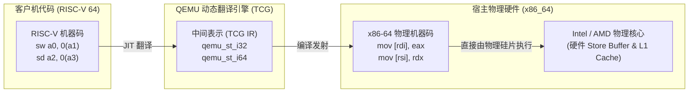
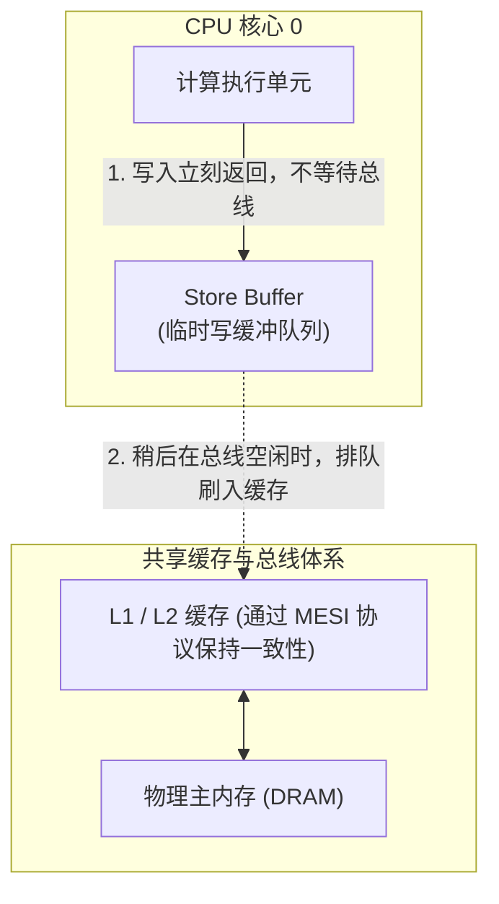
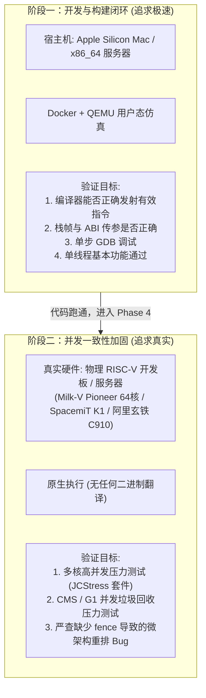

# 05 - QEMU on x86 仿真环境下的内存模型鸿沟与 RVWMO 漏洞掩盖深度解析

> **适用读者**：HotSpot 移植工程师、底层系统研发人员、未深入接触过 QEMU TCG 机制的开发者。  
> **核心议题**：为什么在 x86 物理机上用 QEMU 模拟 RISC-V 执行 HotSpot 时，即使汇编代码遗漏了关键内存屏障（`fence`），多线程并发测试依然能够 100% 成功？这种“虚假安全性”从何而来？

---

## 目录
1. [从零认识 QEMU：它在 x86 上究竟是如何运行 RISC-V 程序的？](#一从零认识-qemu它在-x86-上究竟是如何运行-risc-v-程序的)
2. [什么是内存一致性模型（Memory Model）？为什么物理硬件会“乱序”？](#二什么是内存一致性模型memory-model为什么物理硬件会乱序)
3. [两大阵营的碰撞：x86 TSO（强模型）vs RISC-V RVWMO（极弱模型）](#三大阵营的碰撞x86-tso强模型vs-risc-v-rvwmo极弱模型)
4. [核心谜底：x86 上的 QEMU 是如何“掩盖”并发 Bug 的？](#四核心谜底x86-上的-qemu-是如何掩盖并发-bug-的)
5. [深度剖析：为什么 QEMU 不主动“模拟”这种弱内存乱序？](#五深度剖析为什么-qemu-不主动模拟这种弱内存乱序)
6. [HotSpot JVM 实战反例：对象构造与并发发布中的致命隐患](#六hotspot-jvm-实战反例对象构造与并发发布中的致命隐患)
7. [移植工程实践：如何规避 QEMU 的“假象”，确保生产级正确性？](#七移植工程实践如何规避-qemu-的假象确保生产级正确性)

---

## 一、从零认识 QEMU：它在 x86 上究竟是如何运行 RISC-V 程序的？

很多开发者直觉上会把 QEMU 想象成一个“软件实现的 CPU 晶体管电路模拟器”，误以为客户机（Guest，这里指 RISC-V）的所有微架构特性都会被一一还原。然而事实完全相反。

### 1.1 纯解释器 vs 动态二进制翻译（Dynamic Binary Translation, DBT）
如果采用纯解释器模式（逐条读取 RISC-V 机器码，用 C 语言 `switch-case` 分派解码），速度极其缓慢，通常比物理机器慢 **100~500 倍**。在这样的速度下，启动一次 JDK 8u 都需要数十分钟。

因此，现代 QEMU 采用了工业级的高性能机制 —— **TCG（Tiny Code Generator，微型代码生成器）**：



### 1.2 核心事实：执行指令的其实是 Intel/AMD 的物理硅片
1. **基本块（Basic Block）即时编译**：当 QEMU 准备执行一段 RISC-V 代码时，它会以基本块为单位，把 RISC-V 指令动态“重新编译”成宿主机（x86-64）的本地汇编指令；
2. **直连物理硬件**：翻译生成的 x86 机器指令被直接灌入 Intel/AMD CPU 的执行流水线中跑；
3. **多线程映射**：Java 层面创建的线程，最终在 Linux 宿主机上表现为原生的操作系统线程（`pthread`）。多核并发时，是由**多个真正的 x86 物理核心在并发读写内存**！

---

## 二、什么是内存一致性模型（Memory Model）？为什么物理硬件会“乱序”？

要理解 Bug 为何被掩盖，必须先理解为什么现代芯片不能简单地“按照代码写的顺序一行行读写内存”。

### 2.1 速度鸿沟（Memory Wall）
* **CPU 寄存器访问**：通常只需 **0.2 ~ 0.5 纳秒**（小于 1 个时钟周期）；
* **DRAM 主内存访问**：通常需要 **50 ~ 100 纳秒**（相当于 200 ~ 300 个时钟周期）；
* 如果 CPU 每次执行写入指令（Store）都要傻等内存确认，CPU 的算力将有 99% 白白浪费在等待总线响应上。

### 2.2 硬件救星：Store Buffer（写缓冲区）
为了让 CPU 核心不被写操作阻塞，现代 CPU 在核心与缓存之间加入了硬件 **Store Buffer**：



* 当 CPU 核心执行 `Store A = 1` 时，它把数据塞进自己的 **Store Buffer** 之后就立刻掉头去执行后面的指令了；
* Store Buffer 会在总线空闲的未来某个时刻，异步把数据刷新到共享的 Cache 中；
* **问题爆发点**：在数据还没有真正刷入 Cache 之前，**其他 CPU 核心根本看不到这个写入！** 如果不同 CPU 核心刷新 Store Buffer 的时序出现交错，在宏观上就会表现为“**内存写入的顺序被颠倒了**”。

---

## 三、两大阵营的碰撞：x86 TSO（强模型）vs RISC-V RVWMO（极弱模型）

硬件厂商在处理“性能优化”与“乱序程度”的权衡时，分裂成了两个极端阵营：

### 3.1 阵营一：x86 的 TSO（Total Store Order，完全存储定序）—— 强内存模型
Intel 和 AMD 投入了海量的晶体管硅片预算来维护极高的内存一致性。在 x86 硬件设计中，**硬件 Store Buffer 必须严格遵守先进先出（FIFO）规则**。

x86 硬件从底层物理上做出了以下极其严格的铁律：
1. **写写不能重排（No Store-Store Reordering）**：核心内先执行的写操作，一定会先于后执行的写操作刷新到共享缓存中；
2. **读读不能重排（No Load-Load Reordering）**：先执行的读操作一定会先读到结果；
3. **读写不能重排（No Load-Store Reordering）**：读操作不会被推迟到后续的写操作之后；
4. **【唯一允许的乱序】写读重排（Store-Load Reordering）**：当前核心写入的数据还在自己的 Store Buffer 里时，后续的一条读指令允许直接从寄存器或缓存里取数，因此其他核心可能先看到“读”后看到“写”。

> **总结**：x86 几乎是最接近程序员“直觉”的架构。在 x86 上写并发代码，通常只需要防范罕见的 Store-Load 乱序，写写操作天然是有序的。

### 3.2 阵营二：RISC-V 的 RVWMO（Weak Memory Ordering）—— 极宽松弱内存模型
RISC-V 诞生于伯克利，其核心哲学是 **“指令集保持精简，硬件实现尽可能低功耗、低硅片面积，将定序的责任交给编译器与程序员”**。

在 RVWMO 规范中，**硬件拥有极致的重排自由度**：
* **写写可以重排（Store-Store Allowed）**：两条写指令如果操作不同地址，硬件想先刷哪一条就先刷哪一条！
* **读读可以重排（Load-Load Allowed）**：两条读指令即使物理先后发射，乱序流水线也可以提前执行后面的读！
* **读写可以重排（Load-Store Allowed）**；
* **写读可以重排（Store-Load Allowed）**。

> **规则**：在 RISC-V 上，除非软件显式发射一条 **`fence`（内存屏障）** 指令，或者在原子指令上加上 `.aq`（Acquire）或 `.rl`（Release）注解，否则硬件流水线默认可以进行**一切合法的任意乱序**！

---

## 四、核心谜底：x86 上的 QEMU 是如何“掩盖”并发 Bug 的？

现在，我们将上面两个拼图拼在一起，还原“Bug 如何被悄然抹平”的犯罪现场。

### 4.1 场景推演：HotSpot 遗漏了关键的写屏障 `fence`

假设我们在移植 HotSpot 时，编写了一段向对象写入属性并发布引用的 RISC-V 汇编代码：

```riscv
# 寄存器状态：
# s1 存放新创建对象的地址
# s2 存放全局静态变量的地址

sw    t0, 0(s1)         # 操作 1 (Store 1): 写入对象字段 field = 100

# ----------------------------------------------------------------------
# 致命工程失误：
# 正确的 RISC-V 汇编必须在这里插入一条: fence rw, w (Release 语义写屏障)
# 但是由于开发者粗心，【完全遗漏了这条 fence 指令】！
# ----------------------------------------------------------------------

sd    s1, 0(s2)         # 操作 2 (Store 2): 将对象引用发布到全局静态变量 global_obj
```

#### 4.2 物理 RISC-V 真实芯片上的表现（真火炼真金）：
1. 物理 RISC-V 乱序核心（如阿里平头哥玄铁 C910、中科院香山、算能 SG2042）执行到这段代码；
2. 由于中间**没有 `fence`**，硬件重排序缓冲区（ROB）发现 `0(s1)` 和 `0(s2)` 是两个完全独立的内存地址；
3. 硬件认为操作 2 比操作 1 更容易分配总线槽位，于是**先将操作 2（发布全局指针）刷入了 L3 Cache**，而操作 1（字段赋值）还在 Store Buffer 里面排队；
4. 另一个物理核心上的 Java 线程 B 并发读取 `global_obj`，发现非空，立刻去读 `field` 属性：
   * **惨剧发生**：线程 B 读到了 `field == 0`（未初始化的原始堆内存）！
   * **后果**：Java 的 `final` 语义被彻底撕毁，系统抛出难以重现的空指针或业务数据错乱。

#### 4.3 在 x86 服务器上通过 QEMU 模拟时的表现（虚假的和平）：
1. QEMU 的 TCG 引擎接收到这两条 RISC-V 指令；
2. TCG 将它们 1:1 翻译为 x86 机器指令：
   ```assembly
   mov dword ptr [rdi], eax   ; 对应 sw t0, 0(s1)
   mov qword ptr [rsi], rdi   ; 对应 sd s1, 0(s2)
   ```
3. QEMU 把这两条 `mov` 交给 Intel/AMD 物理核心执行；
4. **关键转折**：
   * Intel/AMD 物理核心的硬件机制是 **TSO**！
   * x86 芯片在硬件物理晶体管层面，**誓死保证 Store-Store 绝对不允许重排**！
   * 哪怕软件里压根没有任何屏障，x86 的硬件 Store Buffer 也会以死板的 FIFO 顺序，先让操作 1 刷入共享缓存，然后再让操作 2 刷入共享缓存！
5. 另一个线程无论跑得多快，**它都绝对不可能先看到操作 2、后看到操作 1**！

> **结论**：  
> 这段代码在 RISC-V 语义下明明是**大错特错**的，但因为它是被放在一台遵循强内存模型的 x86 物理机上被 QEMU 动态翻译执行的，**x86 的物理硬件替你的烂代码擦了屁股，擦得干干净净！**  
> 你的自动化测试套件跑 1000 万次，结果全部都是“PASSED”，给人一种代码完美无瑕的错觉。

---

## 五、深度剖析：为什么 QEMU 不主动“模拟”这种弱内存乱序？

既然 QEMU 是模拟器，为什么它不主动在软件层面制造随机乱序来暴露这种 Bug 呢？

### 5.1 性能代价不可承受（From 50% to 0.01%）
* QEMU TCG 的设计首要指标是 **执行吞吐量**。它把客户机指令翻译成尽量少、尽量高效的宿主机指令；
* 如果要在软件中完全模拟 RVWMO 弱内存模型：
  * QEMU 必须为每个虚拟 CPU 维护一个复杂的软件 Store Buffer；
  * 每次内存读写都不能直接执行宿主机的 `mov`，而是必须把写入包装成带有时间戳的数据结构，放进软件队列，并引入随机发生器来模拟不同核心的非确定性乱序；
  * 每次读操作都要去所有核心的软件写队列中进行全局窥探（Snooping）；
  * **结果**：仿真执行速度将骤降 **3 到 4 个数量级**。跑一个 Java HelloWorld 就会从 1 秒变成几十分钟，完全失去日常开发调试的工程价值。

### 5.2 宿主硬件没有反向指令
x86 硬件只提供了“强化内存屏障”的指令（如 `mfence`, `sfence`, `lfence`），**没有任何一条硬件指令能告诉 x86：“请把接下来的两条写入操作故意乱序执行”**。硬件本身没有提供削弱自身一致性的能力。

---

## 六、HotSpot JVM 实战反例：对象构造与并发发布中的致命隐患

在 HotSpot 中，这种陷阱具体会埋在哪些代码里？以下列举三个真实移植高危场景：

### 6.1 场景 A：模板解释器的引用字段赋值（`putfield`）
在 [`hotspot/src/cpu/riscv/vm/templateTable_riscv_64.cpp`](file:///Users/wujiahua/code/riscv-port-jdk8u/hotspot/src/cpu/riscv/vm) 中实现 `putfield` 字节码：
* 当向一个对象字段写入引用时，如果不加区分地发射指令，缺少发布屏障，分配对象的一方与读取对象的一方就会发生严重的数据竞争；
* 在 x86 上：普通的 `mov` 即自带 Release 语义；
* 在 RISC-V 上：必须通过 [`macroAssembler_riscv.cpp`](file:///Users/wujiahua/code/riscv-port-jdk8u/hotspot/src/cpu/riscv/vm) 发射显式的 `fence rw, w` 或者 `membar(StoreStore)`。

### 6.2 场景 B：并发标记与垃圾回收写屏障（GC Write Barriers）
在 CMS 的 `store-check` 并发标记屏障或 G1 的 SATB 队列写入中：
* 垃圾回收线程在后台并发遍历对象图，业务应用线程（Mutator）在前台修改指针；
* 前台线程修改对象字段后，必须保证被修改的地址或卡表（Card Table）以严格的时序对 GC 线程可见；
* 如果在更新卡表字节（`byte_map_base`）时缺少了内存依赖屏障，GC 线程可能会跳过某些已经被修改的对象，导致活跃对象被错误当成垃圾回收，产生不可预测的堆损坏（Heap Corruption Crash）。

### 6.3 场景 C：JVM 内部锁与原子操作（`OrderAccess`）
在 [`hotspot/src/os_cpu/linux_riscv/vm/orderAccess_linux_riscv.inline.hpp`](file:///Users/wujiahua/code/riscv-port-jdk8u/hotspot/src/os_cpu/linux_riscv/vm) 中：
* `OrderAccess::storestore()`
* `OrderAccess::release()`
* `OrderAccess::acquire()`
如果这里把 RISC-V 的 `fence` 指令编码写错（例如本该是 `fence rw, w` 却误写成了空操作或者错误的保留位）：
* **在 x86 QEMU 下**：即使实现是空的，JVM 也能顺畅跑通所有基本测试；
* **在真实芯片下**：高并发压测几个小时后，由于锁状态与受保护数据之间发生乱序，多线程锁完全失效，进程直接挂死或 Abort。

---

## 七、移植工程实践：如何规避 QEMU 的“假象”，确保生产级正确性？

既然 QEMU on x86 存在如此隐蔽的“善意欺骗”，我们在工程上应该如何科学应对？

### 7.1 分阶段的“双轨验证体系”（Two-Track Verification）



### 7.2 核心代码层面的“静态防线”
1. **严格对照主线（JDK 21+）实现**：
   * 不要凭个人直觉手写内存屏障，优先对照主线成熟的 `macroAssembler_riscv.cpp` 与 `orderAccess_linux_riscv.inline.hpp` 中的屏障发射逻辑；
2. **规范命名与使用 `membar` 宏**：
   * 在汇编代码中明确标注使用的是 `StoreStore`, `LoadStore`, `StoreLoad` 还是 `Acquire/Release` 语义，让 Code Review 人员能够逐行核对屏障的成对出现；
3. **引入形式化或并发测试工具（JCStress）**：
   * 在进入真实物理机测试阶段后，全量运行 OpenJDK 官方的 **JCStress（Java Concurrency Stress tests）** 套件。该套件专为暴露硬件内存模型重排而设计，能在数亿次并发竞态中精准捕捉因缺失 `fence` 导致的数据一致性撕裂。

---
*本文档为团队内部核心系统设计资料，归档于 [`docs/05-QEMU-X86-MEMORY-MODEL-ANALYSIS.md`](file:///Users/wujiahua/code/riscv-port-jdk8u/docs/05-QEMU-X86-MEMORY-MODEL-ANALYSIS.md)。*
