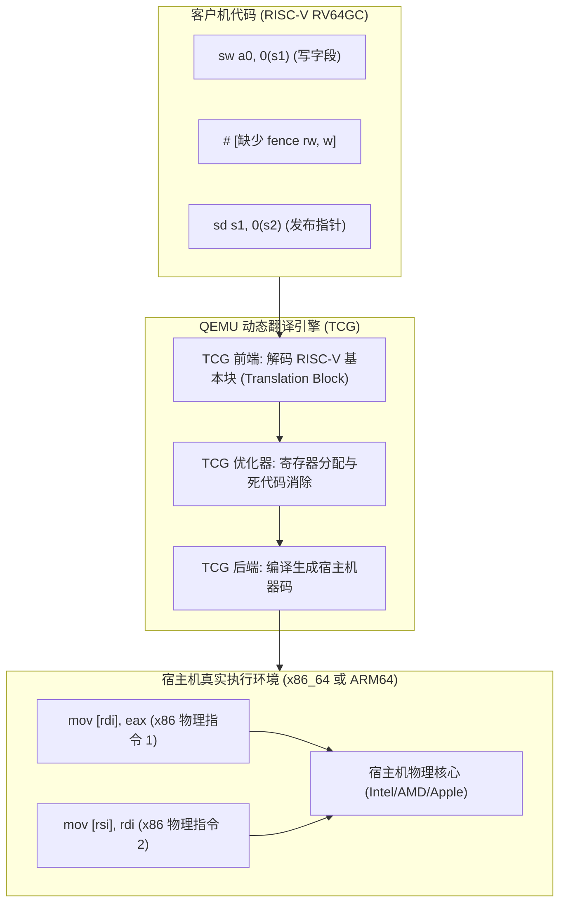
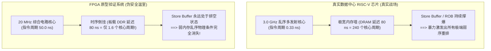
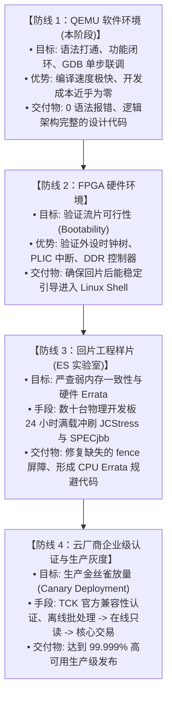

# 06 - 为什么 QEMU 与 FPGA 仿真在物理与架构层面均无法验证多核弱内存并发（RVWMO）与生产级 JVM 稳定性

> **适用读者**：JVM 架构师、HotSpot 移植工程师、操作系统内核开发者、体系结构验证工程师。  
> **核心议题**：深入剖析 QEMU（动态二进制翻译）与 FPGA 原型验证在微架构时钟、流水线模型、总线互联与内存一致性层面的固有物理局限，彻底解答“为什么在 QEMU 和 FPGA 上 100% 跑通测试的 JVM 代码，放到真实数据中心级多核物理芯片上依然会面临崩溃风险”。

---

## 目录
1. [前言：工业界的“仿真幻象”与核心悖论](#一前言工业界的仿真幻象与核心悖论)
2. [QEMU TCG 动态二进制翻译：为什么无法暴露弱内存乱序？](#二qemu-tcg-动态二进制翻译为什么无法暴露弱内存乱序)
   * 2.1 TCG 动态翻译的基本块模型与执行本质
   * 2.2 宿主架构的“李代桃僵”：x86 TSO 与 ARM64 的保序掩盖
   * 2.3 为什么 QEMU 在工程上绝对不能去“模拟乱序”？
3. [FPGA 原型验证的物理死穴：为什么同样无法拦截并发灾难？](#三fpga-原型验证的物理死穴为什么同样无法拦截并发灾难)
   * 3.1 死穴一：时钟频率陷阱（10MHz vs 3GHz 的百倍时间扩张）
   * 3.2 死穴二：核心与主存时序“倒挂”（Memory Wall 彻底失真）
   * 3.3 死穴三：门级逻辑容量壁垒与跨片互联失真（无法模拟 64/128 核）
   * 3.4 FPGA 在工业界体系中的真实定位与能力边界
4. [QEMU 与 FPGA 必然漏检的四大类 JVM 核心缺陷](#四qemu-与-fpga-必然漏检的四大类-jvm-核心缺陷)
   * 4.1 字段未初始化与对象安全发布撕裂
   * 4.2 并发 GC 卡表写屏障与 SATB 队列标记丢失
   * 4.3 JIT 机器码发射与 I-Cache / D-Cache 一致性（`fence.i` 广播缺失）
   * 4.4 硬件原子原语（LR/SC vs AMO）在超多核下的活锁与饥饿
5. [数据中心芯片落地闭环：从“图纸”到“生产就绪”的科学分工体系](#五数据中心芯片落地闭环从图纸到生产就绪的科学分工体系)

---

## 一、前言：工业界的“仿真幻象”与核心悖论

在体系结构移植与基础软件研发中，初学者极易产生一个致命误区：  
> *“只要我们在 QEMU 模拟器里把测试套件跑通，或者把硬件 RTL 代码烧进 FPGA 里点亮 Linux，我们就已经拥有了生产可用的软件系统。”*

这在单线程、无自修改代码的简单 C 程序中或许大致成立；但对于 **OpenJDK HotSpot JVM 这种极其庞大、重度依赖运行时 JIT 动态代码发射、多线程高并发无锁协作、多核心垃圾回收并发扫描的工业级重型软件**，这种假设是完全错误的。

这里存在一个根本性的范式鸿沟：
* **功能语义正确性（Functional Correctness）**：给定固定的指令输入，指令是否产生了符合规范的数值输出？（QEMU 与 FPGA 可以 100% 验证）；
* **微架构与内存一致性正确性（Microarchitectural & Memory Consistency Correctness）**：在数十个物理核心激进推测、乱序发射、多级私有缓存失效与总线仲裁的极限物理冲刷下，内存写入的可见性时序是否符合 Java 内存模型（JMM）的偏序关系？（**QEMU 与 FPGA 在物理层面完全无法验证！**）。

---

## 二、QEMU TCG 动态二进制翻译：为什么无法暴露弱内存乱序？

### 2.1 TCG 动态翻译的基本块模型与执行本质
QEMU 用户态仿真（`qemu-riscv64`）不是一个周期级硬件模拟器（如 gem5），而是一个采用 **TCG（Tiny Code Generator）** 的动态二进制翻译器（DBT）：



1. **基本块划分**：QEMU 以跳转指令（Branch/Jump）为边界，将一段 RISC-V 指令切分成一个翻译块（Translation Block, TB）；
2. **中间表示发射**：每条 RISC-V 指令被映射为 TCG IR（如 `qemu_st_i32`）；
3. **原生代码生成**：TCG 后端将 TCG IR 1:1 编译为宿主机的本地汇编指令（如 x86 的 `mov`）；
4. **内核线程直挂**：Java 线程通过 Linux `clone` 创建后，QEMU 将其直接绑定到宿主机操作系统的内核线程（Pthread）。这意味着，**指令最终是被你 Mac 或 Linux 服务器上的物理硅片核心原生执行的**。

### 2.2 宿主架构的“李代桃僵”：x86 TSO 与 ARM64 的保序掩盖
当执行一段存在弱内存屏障缺失的 RISC-V 汇编时，决定其读写时序的根本不是 RISC-V 规范，而是**宿主 CPU 物理芯片的内存模型**：

| 内存重排序类型 | RISC-V RVWMO 规范允许？ | x86-64 物理硬件允许？ | Apple Silicon (ARM64) 物理硬件允许？ | QEMU on x86 的真实行为 |
| :--- | :--- | :--- | :--- | :--- |
| **Store-Store（写写乱序）** | **允许（默认乱序）** | **绝对禁止（严格 FIFO）** | 允许（但在深流水线中有局部保护） | **被 x86 硬件强行保序，Bug 永远隐形** |
| **Load-Load（读读乱序）** | **允许（默认乱序）** | **绝对禁止（严格保序）** | 允许 | **被 x86 硬件强行保序，Bug 永远隐形** |
| **Load-Store（读写乱序）** | **允许（默认乱序）** | **绝对禁止（严格保序）** | 允许 | **被 x86 硬件强行保序，Bug 永远隐形** |
| **Store-Load（写读乱序）** | **允许（默认乱序）** | **唯一允许的重排** | 允许 | 偶尔发生 |

* **x86 的全面掩盖**：x86 是硬度极高的 TSO（Total Store Order）模型，硬件底座把除了 Store-Load 以外的所有内存重排全部物理抹杀。你在 HotSpot 里哪怕把所有写写屏障（`fence rw, w` / `StoreStore`）统统删光，代码在 x86 QEMU 上跑 10 亿次，通过率依然是 100%！
* **ARM64（Mac）的局部掩盖**：尽管 ARM64 也是弱内存模型，但 QEMU 在翻译每一条客户机指令时，不可避免地会插入辅助寄存器保护、PC 计数器维护等中间机器指令，无形中人为拉开了两条内存访问的物理时钟距离，使得物理竞争窗口（Racy Window）的出现概率降低了数个数量级。

### 2.3 为什么 QEMU 在工程上绝对不能去“模拟乱序”？
很多系统工程师会问：*“QEMU 既然是模拟器，为什么不在软件里建立一个虚拟乱序队列，故意随机打乱指令执行顺序来测试弱内存？”*

在工程实践上，这属于“理论可行，工程自杀”：
1. **性能崩塌数学推导**：
   * 原生 QEMU TCG 执行一条内存写入：直接发射一条宿主 `mov`，耗时 $\approx 1$ 个时钟周期；
   * 软件模拟 RVWMO 弱内存模型：
     * 必须为每个 vCPU 维护软件 Store Buffer 与 Invalidate Queue；
     * 每次写操作必须封装成带逻辑时间戳（Lamport Timestamp）的节点，塞入全局乱序图；
     * 每次读操作必须遍历全系统所有核心的未落盘队列进行软件 Snooping 探查，并引入伪随机数发生器计算总线仲裁延迟；
     * 单次内存读写的时间复杂度从 $O(1)$ 骤升至 $O(N_{\text{cores}} \times \text{QueueDepth})$；
   * **实测结果**：QEMU 的吞吐量会从原生性能的 **30%~50% 骤降至 0.01%**（慢 1000 到 10000 倍）。跑一个最轻量的 `java -version` 耗时将从 0.5 秒膨胀到半小时以上，日常开发调试彻底瘫痪。
2. **物理指令单向性**：
   * x86 硬件只提供加固内存屏障的指令（如 `mfence`, `lfence`），**物理晶体管层面不存在任何一条指令能命令 CPU：“请把下面两条写入操作反向执行”**。软件无法让强内存硬件展现出真实的弱内存物理特性。

---

## 三、FPGA 原型验证的物理死穴：为什么同样无法拦截并发灾难？

如果说软件 QEMU 无法模拟是因为动态翻译机制，那么很多人寄予厚望的 **FPGA（把真实的 RISC-V 乱序核 RTL 电路烧录进可编程芯片）**，为什么同样无法作为多核弱内存并发的“终极裁判”？



### 3.1 死穴一：时钟频率陷阱（10MHz vs 3GHz 的百倍时间扩张）
* **物理主频差距**：
  * 真实的数据中心芯片（如基于 TSMC 5nm/4nm 工艺的 64 核 RISC-V 服务器），工作主频在 **2.5 GHz ~ 3.5 GHz**；
  * 而在顶级 FPGA（如 Xilinx UltraScale+ VU19P）上，复杂的现代多发射乱序核心经过综合、布局布线后，受限于内部可编程开关矩阵（Switch Matrix）的布线 RC 延迟，工作主频通常只有 **10 MHz ~ 50 MHz**；
  * **主频相差了 100 到 300 倍！**
* **对 JVM 测试的致命打击**：
  * HotSpot 具有典型的“长预热”特性。启动一个中型 Spring Boot 压测应用，在 3GHz 真实机器上预热 JIT 分层编译需要 15 秒；在 20MHz 的 FPGA 上需要 **近 2 个小时**；
  * 一次 72 小时的企业级 SPECjbb2015 极限耐力并发压测，在 FPGA 上需要连续跑 **将近 1 整年（8760 小时）**。在商业工程节奏中，根本不可能用 FPGA 跑完深度并发测试矩阵。

### 3.2 死穴二：核心与主存时序“倒挂”（Memory Wall 彻底失真）
这是体系结构中最隐蔽、却最具毁灭性的物理失真：

* **在真实 3GHz 物理芯片上**：
  * 核心时钟极其微小（$\tau_{\text{core}} = 0.33\,\text{ns}$）；
  * 主存 DDR 延迟极其漫长（$t_{\text{DDR}} \approx 80\,\text{ns}$，折合 **240 个 CPU 时钟周期**）；
  * **极端的内存墙（Memory Wall）** 导致核心的 Store Buffer、写合并缓冲区（WCB）和重排序缓冲区（ROB）在极短时间内被彻底塞满；
  * 当缓冲区塞满溢出时，硬件仲裁机制被迫采取极其激进的推测丢弃、乱序广播与局部 bypass，**那些隐藏在代码最深处的屏障遗漏 Bug 就是在这一瞬间被暴力挤压出来的**！
* **在 20MHz 的 FPGA 上**：
  * 核心时钟被大幅拉长（$\tau_{\text{core}} = 50.0\,\text{ns}$）；
  * 板载物理 DDR 内存的实际响应时间依然是 $\approx 80\,\text{ns}$；
  * **换算为核心周期：主存访问只需要 $80 / 50 = 1.6$ 个核心周期！**
  * **物理现象倒挂**：在 FPGA 眼里，原本缓慢的主存变成了类似“片上高速 L1 Cache”一样的存在！核心的 Store Buffer 永远是**空的**，刚写入的数据下一拍就直接写入主存了。硬件根本不需要也来不及进行激进的并发乱序调度。
  * **结论**：**导致多核弱内存 Bug 爆发的微架构物理温床，在 FPGA 上被物理消解了！**

### 3.3 死穴三：门级逻辑容量壁垒与跨片互联失真（无法模拟 64/128 核）
* **单核资源吞吐极限**：
  * 一个能够满足数据中心吞吐要求的高性能 RISC-V 核心（例如中科院香山-昆明湖架构，8 宽乱序发射、300+ ROB、大容量 L2 Cache、支持 RVV 1.0 矢量），其综合后的等效逻辑门数高达数千万；
  * 单颗造价数十万元的顶级 FPGA，拼尽所有 LUT 和 BRAM 资源，**最多只能塞下 1 到 2 个这样的高性能乱序核心**！
* **跨 FPGA 互联的悲剧**：
  * 要模拟 64 核或 128 核，必须采购包含数十块 FPGA 的超大型硬件仿真加速箱（如 Cadence Palladium、Synopsys ZeBu，整机造价数千万至上亿元人民币）；
  * 多块 FPGA 之间的片上网络（Mesh NoC / TileLink / CHI）必须被切断，通过 PCB 铜线走高速 SerDes 进行串行化传输；
  * 跨芯片布线延迟将整个系统的全局时钟拉低到 **1 MHz ~ 5 MHz**，且节点间的网络延迟比例被彻底扭曲，完全丧失了对片上多核高并发竞争状态的仿真保真度。

### 3.4 FPGA 在工业界体系中的真实定位与能力边界
既然 FPGA 无法验证 JVM 弱内存并发，它在芯片开发中的真正价值到底是什么？
* **FPGA 唯一不可替代的使命：确保流片回片（Tape-out）后“能够开机（Bootability）”**：
  1. 验证中断控制器（PLIC / AIA）与外设时钟树配置是否死锁；
  2. 验证 PCIe 控制器、以太网 MAC 与 DDR 控制器物理层时序状态机；
  3. 验证 Linux 内核引导代码、设备树（Device Tree）解析与单核冒烟测试；
  4. 验证 JTAG 调试链路（OpenOCD）能不能挂上 CPU。
* **对于“64 核高并发 GC 垃圾回收、JIT 机器码并发修补、JCStress 弱内存压测”，FPGA 从设计之初就不是干这个的！**

---

## 四、QEMU 与 FPGA 必然漏检的四大类 JVM 核心缺陷

在 HotSpot 源码中，究竟有哪些致命缺陷能够完美逃过 QEMU 和 FPGA 的双重检查，最终在物理芯片上酿成大祸？

### 4.1 字段未初始化与对象安全发布撕裂
在 Java 虚拟机中，对象构造与发布的汇编逻辑：
```riscv
# 线程 A：执行 new Point(10, 20)
sw    t0, 0(s1)         # 写入字段 x = 10
sw    t1, 4(s1)         # 写入字段 y = 20

# -------------------------------------------------------------
# 缺陷：遗漏了 fence rw, w (Release 屏障)
# -------------------------------------------------------------

sd    s1, 0(s2)         # 将对象地址发布给全局静态变量 GlobalPoint
```
* **在 x86 QEMU 上**：x86 硬件禁止写写重排，`x` 和 `y` 必然先于 `GlobalPoint` 写入缓存；
* **在 FPGA 上**：内存访问只要 1.6 个周期，Store Buffer 永远是空的，写入顺序严格保持；
* **在 64 核物理 RISC-V 服务器上**：核心 ROB 发现两个写入地址不相干，利用乱序窗口先将 `GlobalPoint` 广播到总线上；另一个核心并发执行 `Point.x`，读到了原始堆内存的 `0`，打破了 Java 语言的语义基石，导致线上业务偶发静默数据损坏！

### 4.2 并发 GC 卡表写屏障与 SATB 队列标记丢失
在 G1 GC 与 CMS 垃圾回收器中，写屏障负责跟踪对象的跨代引用：
* 业务线程（Mutator）修改堆中指针后，必须更新卡表（Card Table）字节并将其置为 Dirty；
* **弱内存灾难**：如果卡表更新与实际对象指针写入之间缺少适当的依赖屏障，GC 线程在后台并发遍历卡表时，可能会先看到对象引用更新被覆盖，却未及时看到卡表标记，导致**存活对象被漏标，在下一个 GC 周期中被当成垃圾错误回收**，引发不可调试的 JVM 内存崩溃（Crash in MarkSweep）。

### 4.3 JIT 机器码发射与 I-Cache / D-Cache 一致性（`fence.i` 广播缺失）
* HotSpot JIT 编译器在内存中动态生成本地机器码，并通过普通数据写入（D-Cache）落盘；
* 当其他核心要执行这段新代码时，必须确保其指令缓存（I-Cache）中的旧指令全部失效；
* **在 QEMU 下**：软件统一管理平坦地址空间，无需关心多核 I-Cache / D-Cache 物理一致性；
* **在真实 128 核物理机上**：一个核心修改代码后，必须通过核间中断（IPI）向所有其他核心广播执行 **`fence.i`**。如果广播时序稍有遗漏，某个核心的 L1 I-Cache 就会读到新旧混合的半条指令，瞬间触发 **`SIGILL`（非法指令异常）** 导致进程就地死亡。

### 4.4 硬件原子原语（LR/SC vs AMO）在超多核下的活锁与饥饿
* 在 64 核 / 128 核高并发锁竞争场景下（如 `AtomicInteger.incrementAndGet()`）：
  * 如果使用传统的 `lr.w` / `sc.w`（保留集 Exclusive Reservation）重试循环；
  * **在 QEMU 与 1~2 核 FPGA 上**：核心数量极少，冲突概率微乎其微，循环 1~2 次必定成功；
  * **在 128 核真实物理服务器上**：128 个核心疯狂互相清空对方的保留集，陷入无休止的重试风暴，**CPU 满载 100% 但业务处理速率跌至零（发生真实活锁 Livelock）**；
  * 唯有直接使用硬件 **AMO 指令（`amoadd.w`）** 将原子计算下沉至片上网络路由器或缓存控制器中单步完成，才能破解此死局。

---

## 五、数据中心芯片落地闭环：从“图纸”到“生产就绪”的科学分工体系

既然 QEMU 和 FPGA 都有各自无法逾越的物理局限，现代芯片巨头与操作系统/JVM 厂商在工程上究竟是如何协作完成生产交付的？

整个交付链条必须清晰划分为四道严格的防线，各司其职，缺一不可：



### 架构师核心结论
1. **不要低估当前 QEMU 工作的价值**：我们在 Phase 0 ~ Phase 3 基于 Docker + QEMU 所做的一切，是在以最高效率画对“发动机图纸”。只有图纸没有低级语法错误，后续的物理机验证才有可能启动；
2. **更不要高估 QEMU 与 FPGA 的测试覆盖度**：时刻保持对多核弱内存模型（RVWMO）与高并发微架构时序的敬畏。所有涉及到 `OrderAccess`、GC 卡表写屏障、Volatile 访问与原子操作的汇编序列，必须在第一天就严格对照主线工业级实现与硬件规范，绝不在并发屏障上心存侥幸！

---
*本文档归档于 [`docs/06-WHY-QEMU-AND-FPGA-CANNOT-VALIDATE-CONCURRENCY.md`](file:///Users/wujiahua/code/riscv-port-jdk8u/docs/06-WHY-QEMU-AND-FPGA-CANNOT-VALIDATE-CONCURRENCY.md)，作为团队底层体系结构与微架构验证标准指南。*
