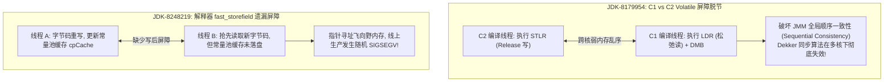
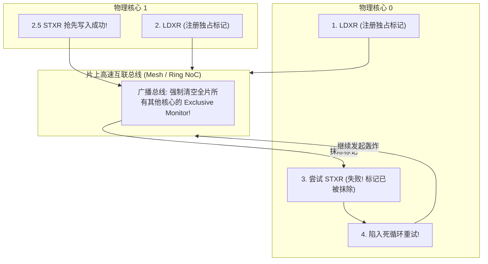

# 07 - 历史的血泪镜鉴：AArch64 服务器芯片商用化初期硬件 Errata 与 HotSpot JVM 弱内存并发缺陷深度实录

> **适用读者**：JVM 架构师、HotSpot 移植工程师、操作系统内核开发者、体系结构验证工程师。  
> **核心宗旨**：前事不忘，后事之师。详尽复盘 2014~2018 年 64 位 ARM（AArch64）服务器芯片从实验室走向真实数据中心生产环境时，在微架构、硬件 Errata、Linux 内核与 HotSpot JVM 弱内存并发领域爆发的一系列毁灭性崩溃故障，作为 OpenJDK 8u RISC-V Port 开发的直接工程戒律。

---

## 目录
1. [前言：为什么 RISC-V 必须复盘 AArch64 的十年血泪史？](#一前言为什么-risc-v-必须复盘-aarch64-的十年血泪史)
2. [HotSpot 源码官方断言：早期服务器工程样片的“断臂求生”](#二hotspot-源码官方断言早期服务器工程样片的断臂求生)
   * 2.1 `vm_version_aarch64.cpp` 现场：直接放弃支持早期硬件
   * 2.2 非对齐内存访问硬件缺陷：强制启用 `AvoidUnalignedAccesses`
   * 2.3 SIMD 字符串比较内存损毁：被迫阉割 `UseSIMDForArrayEquals`
3. [OpenJDK JBS 官方经典战役：QEMU 无法发现的弱内存并发崩溃](#三openjdk-jbs-官方经典战役qemu-无法发现的弱内存并发崩溃)
   * 3.1 **JDK-8179954**：C1 与 C2 的 Volatile 屏障不一致导致 Java 顺序一致性彻底撕毁
   * 3.2 **JDK-8248219**：解释器 `fast_storefield` 遗漏屏障导致生产环境随机 `SIGSEGV`
   * 3.3 **JDK-8369506 / 8371049**：字节码重写引发 Java 堆损坏与“非空断言抛 NPE”幽灵
   * 3.4 **JDK-8327647**：SPECjvm2008 压测偶发 `markWord::displaced_mark_helper()` 崩溃
   * 3.5 **JDK-8233839**：对象数组分配存根缺少屏障导致引用安全发布失败
4. [多核总线雪崩：Cavium 48~96 核与 LL/SC 硬件活锁（Livelock）纪实](#四多核总线雪崩cavium-4896-核与-llsc-硬件活锁livelock纪实)
   * 4.1 LL/SC 独占监视器（Exclusive Monitor）在 96 核下的互锁风暴
   * 4.2 硬件反思与架构救赎：ARMv8.1-A LSE（Large System Extensions）原子指令的诞生
5. [Linux 内核官方勘误档案：ThunderX 硬件缺陷补丁清单](#五linux-内核官方勘误档案thunderx-硬件缺陷补丁清单)
   * 5.1 `Documentation/arm64/silicon-errata.rst` 解密
   * 5.2 流水线重排、上下文切换与 GICv3 中断总线勘误
6. [对 OpenJDK 8u RISC-V Port 的生死警示与工程规范](#六对-openjdk-8u-risc-v-port-的生死警示与工程规范)

---

## 一、前言：为什么 RISC-V 必须复盘 AArch64 的十年血泪史？

今天我们在 Apple Silicon Mac 上通过 Docker + QEMU 开发 RISC-V 端口，体验流畅、单测全绿。这种温馨的开发环境，与 10 年前（2014~2015 年）AArch64 团队在 Linux x86 宿主机上通过早期 QEMU 移植 OpenJDK 8 的场景**完全如出一辙**。

然而，历史给所有体系结构工程师留下了极其深刻的教训：  
**“在软件模拟器里运行顺利的弱内存架构指令流，一旦踏上真实的多核、多 Socket、深流水线物理服务器芯片，就会立刻遭受毁灭性的物理现实毒打。”**

当年，AppliedMicro X-Gene（8核乱序）、Cavium ThunderX（48核/双路96核）、以及后来的华为海思鲲鹏 920（64核/双路128核）和 AWS Graviton 陆续回片点亮。当真实的 Java 大数据与微服务负载跑上去后，内存踩踏、死锁、无锁队列挂死、GC 堆损坏像暴风雨一样袭来。

Red Hat、Linaro、ARM、Oracle 与华为的 JVM 架构师团队整整耗费了 **3 到 4 年** 的时间，才在物理服务器上将这些深不见底的微架构重排序与硬件 Errata 彻底抚平。

今天，RISC-V 正在昂首迈向高性能数据中心。我们必须将这些血淋淋的案例铭刻于心，绝不在同一个陷阱里跌倒两次。

---

## 二、HotSpot 源码官方断言：早期服务器工程样片的“断臂求生”

打开 OpenJDK 源码中的 [`hotspot/src/cpu/aarch64/vm/vm_version_aarch64.cpp`](file:///Users/wujiahua/code/riscv-port-jdk8u/hotspot/src/cpu/aarch64/vm/vm_version_aarch64.cpp)，直到最新的 JDK 主线中，你依然能清晰地读到当年架构师们面对早期硬件 Bug 时无可奈何写下的防御性代码：

```cpp
if (_cpu == CPU_CAVIUM && (_model == 0xA1)) {
    // 官方源码直接写明：由于硬件缺陷过大，彻底放弃支持早期预发布工程样片！
    guarantee(_variant != 0, "Pre-release hardware no longer supported.");

    // 早期芯片无法可靠处理非对齐内存读写，强制 HotSpot 规避非对齐访问
    if (FLAG_IS_DEFAULT(AvoidUnalignedAccesses)) {
        FLAG_SET_DEFAULT(AvoidUnalignedAccesses, true);
    }
    // 控制 SIMD 向量化内存操作的使用条件
    if (FLAG_IS_DEFAULT(UseSIMDForMemoryOps)) {
        FLAG_SET_DEFAULT(UseSIMDForMemoryOps, (_variant > 0));
    }
    // 早期芯片的 NEON SIMD 字符串比较存在硬件缺陷，强制全系统禁用！
    if (FLAG_IS_DEFAULT(UseSIMDForArrayEquals)) {
        FLAG_SET_DEFAULT(UseSIMDForArrayEquals, false);
    }
}
```

### 2.1 现场剖析：`guarantee(_variant != 0)`
* **背景**：Cavium ThunderX CN88xx（Pass 1.x / `_variant == 0`）是第一代回片的工程样片；
* **现实**：该版本芯片内部的缓存一致性控制器和流水线存在未修复的严重物理缺陷（Silicon Errata）。JVM 运行一会儿就会发生不可恢复的硬件挂起或寄存器内容突变；
* **后果**：开源社区最终在 HotSpot 中硬编码了断言：**凡是检测到该硬件步进的芯片，JVM 在启动初始化阶段直接 `guarantee` 崩溃退出，拒绝运行！**

### 2.2 非对齐内存访问硬件缺陷：`AvoidUnalignedAccesses = true`
* **问题**：在标准 ARMv8 规范中，大多数非对齐内存加载/存储由硬件透明处理；
* **硬件失误**：早期服务器芯片在处理跨 64 字节 Cache Line 边界的非对齐访问时，其微架构加载单元（Load Queue）可能会丢失部分字节或产生极其惊人的性能惩罚（甚至触发总线异常）；
* **HotSpot 妥协**：JVM 必须关闭所有内联展开的高性能未对齐读写优化，改用多条单字节/双字节对齐拼装指令，以牺牲性能为代价换取系统不崩。

### 2.3 SIMD 字符串比较内存损毁：`UseSIMDForArrayEquals = false`
* **问题**：Java 中高频调用的 `String.equals` 和 `Arrays.equals` 依赖 NEON 128 位向量指令做并行比较；
* **硬件失误**：早期芯片在执行特定 SIMD 指令并发生跨页访问或并发总线窥探时，返回的比对标志位存在硬件竞争漏洞，导致完全相同的字符串被判定为不相等，或者读取越界触发非法内存访问；
* **HotSpot 妥协**：直接在启动标志位中强制关闭 `UseSIMDForArrayEquals`，退回低速标量汇编比对。

---

## 三、OpenJDK JBS 官方经典战役：QEMU 无法发现的弱内存并发崩溃

以下是真实记录在 OpenJDK 缺陷跟踪系统（JBS）中的五个教科书级经典 Bug，它们生动展示了**“弱内存模型是如何在物理机上撕碎软件代码的”**。



### 3.1 [JDK-8179954](https://bugs.openjdk.org/browse/JDK-8179954) —— C1 与 C2 的 Volatile 屏障不一致导致 Java 顺序一致性彻底撕毁
* **缺陷级别**：**P2（严重体系结构正确性缺陷）**
* **故障现象**：在 ARM64 多核服务器上运行高并发 Java 框架时，双重检查锁定（DCL）和基于 `volatile` 的经典无锁并发算法（如 Dekker 互斥算法）偶发性失效，多个线程同时闯入临界区，业务数据发生静默踩踏。
* **技术根因深度还原**：
  * Java 内存模型（JMM）对 `volatile` 的要求极其严苛：**全系统所有线程必须以完全相同的全局一致顺序（Sequentially Consistent）观察到所有 volatile 变量的写入**；
  * HotSpot AArch64 后端由不同的工程师开发，产生了一个致命的架构脱节：
    * **C2 编译器后端**：采用了 ARMv8 引入的高性能单向 Acquire/Release 指令 —— 用 `STLR` 实现 volatile store，用 `LDAR` 实现 volatile load；
    * **C1 编译器与解释器后端**：采用了传统的松弛内存访问指令 —— 用普通的 `STR` / `LDR`，并在其前后插入独立的全屏障指令 `DMB ISH`；
  * **弱内存物理总线的残酷反噬**：
    * 当核心 0 运行 C2 生成的代码执行 `STLR`（写入变量 X）；
    * 核心 1 运行 C1 或解释器代码执行 `LDR` + `DMB`（读取变量 Y，写入变量 X）；
    * **在 ARMv8 弱内存体系规范中：单向的 `STLR` 只能保证自身之前的内存操作不漂移到其后，但当它与对端的普通 `LDR` + `DMB` 交互时，总线硬件允许不同核心看到不一致的变量落盘全局顺序！**
    * 两个核心互相认为对方还没有写入，双方同时进入临界区，JMM 规范在底层硬件上被彻底击穿！
* **修复方案**：架构师团队紧急发布补丁，强制重构 AArch64 后端的分层编译屏障生成模型，确保解释器、C1 与 C2 在 volatile 的访问语义上 100% 达成完全对齐。

---

### 3.2 [JDK-8248219](https://bugs.openjdk.org/browse/JDK-8248219) —— 解释器 `fast_storefield` 遗漏屏障导致生产环境随机 `SIGSEGV`
* **缺陷级别**：**P3（生产环境随机崩溃）**
* **故障现象**：在华为鲲鹏等 AArch64 物理服务器上，Java 业务服务在冷启动高并发加载阶段，JVM 进程频繁无预警收到 `SIGSEGV` 崩溃死亡；但在单核环境或 x86 QEMU 模拟器下跑数万次测试全部平稳通过。
* **技术根因深度还原**：
  * HotSpot 模板解释器拥有一项高频优化 —— **运行时字节码自重写（Bytecode Rewriting）**：
    * 当一个类的字段第一次被访问时，字节码是通用的 `getfield` / `putfield`；
    * 解释器解析完符号引用后，会把解析好的元数据写入常量池缓存（`cpCache`）；
    * 随后，解释器会将代码段中的字节码动态覆写为快速专用指令 `fast_accessfield` / `fast_storefield`，以便下次跳过符号解析；
  * **写屏障缺失现场**：
    * 线程 A 在物理核心 0 上解析完毕，执行步骤 1：写入 `cpCache`；执行步骤 2：覆写操作码为 `fast_storefield`；
    * **在这两个写操作之间，汇编代码遗漏了一条 `dmb ishst`（StoreStore 内存屏障）！**
    * 在 x86 宿主机上，硬件 Store Buffer 强制先进先出，步骤 1 必然先于步骤 2 落盘，永远不出事；
    * **在 ARM64 物理服务器上**：核心 0 的 Store Buffer 发生写写乱序，先将步骤 2（改写后的操作码）刷入共享总线；
    * 物理核心 1 上的线程 B 看到操作码变成了 `fast_storefield`，兴高采烈地拿着偏移量去读 `cpCache`；
    * **灾难降临**：核心 1 读到的 `cpCache` 字段偏移量还是未落盘的原始垃圾数据（空指针或负数偏移），指针算错，直接解引用到非法内核内存地址，硬件立刻触发 MMU 缺页异常，抛出 `SIGSEGV` 崩溃！

---

### 3.3 [JDK-8369506](https://bugs.openjdk.org/browse/JDK-8369506) / [JDK-8371049](https://bugs.openjdk.org/browse/JDK-8371049) —— 字节码重写引发 Java 堆损坏与“非空断言抛 NPE”幽灵
* **缺陷级别**：**P2（数据完整性损毁）**
* **故障现象**：在真实服务器运行一段时间后，GC 扫描线程在遍历对象图时因读取到损坏的 Oops（对象指针）而自杀；Java 业务代码中类似于 `assert obj != null` 的地方，居然在紧接着执行 `obj.toString()` 时抛出了 `NullPointerException`。
* **技术根因**：ARM64 硬件具有极其凶悍的 **推测执行与推测加载（Speculative Load）** 能力。在没有显式数据依赖屏障的情况下，CPU 硬件流水线会“预测”读取后续内存，导致读取操作在时间轴上大幅提前发生，打破了软件原本设想的依赖顺序。最终通过在重写路径上追加严格的体系结构屏障（Architecture Barriers）才得以平息。

---

### 3.4 [JDK-8327647](https://bugs.openjdk.org/browse/JDK-8327647) —— SPECjvm2008 压测偶发 `markWord::displaced_mark_helper()` 崩溃
* **缺陷级别**：**P3（基准测试间歇性崩溃）**
* **故障现象**：在跑工业级标准测试 SPECjvm2008 的 Sunflow 多线程光线追踪渲染场景时，虚拟机在对象监视器解锁逻辑中崩溃在 `displaced_mark_helper`。
* **技术根因**：
  * Java 对象头（markWord）在发生轻量级锁（Thin Lock）竞争时，会将原始的对象头 Displaced 到当前线程栈上的 Lock Record 中；
  * 在解锁还原对象头时，读取对象头锁标志位与读取 Lock Record 内容之间**缺少了一条 `LoadLoad` 屏障**；
  * 在超多核并发总线竞争下，后一条读指令被硬件流水线提前执行，读到了已被其它线程覆盖的脏数据，导致恢复对象头时破坏了堆对象元数据。

---

### 3.5 [JDK-8233839](https://bugs.openjdk.org/browse/JDK-8233839) —— 对象数组分配存根缺少屏障导致引用安全发布失败
* **故障现象**：Java 线程通过 JIT 编译生成的 `NewObjectArrayStub` 分配了一个新的对象数组并发布出去，另一个线程立即遍历数组，却读到了数组长度为 0 或数组元素指针损坏。
* **技术根因**：在 HotSpot 的汇编运行时存根（Runtime Stub）中，分配内存、填充数组头部元数据（Klass* 和 length）与向调用者返回指针之间，缺少向外部世界广播的 Release 屏障，导致对象数组被不安全发布。

---

## 四、多核总线雪崩：Cavium 48~96 核与 LL/SC 硬件活锁（Livelock）纪实

除了内存屏障遗漏，AArch64 落地初期最震撼整个体系结构界的事件，莫过于 **超多核体系下的 LL/SC 原子指令雪崩**。



### 4.1 LL/SC 独占监视器在 96 核下的互锁风暴
在 ARMv8.0 规范中，所有无锁原子操作（如 `AtomicInteger.getAndIncrement()`、JVM 内部自旋锁）全部由 **LL/SC（Load-Link / Store-Conditional，即 `LDXR` / `STXR` 指令对）** 实现：

1. **工作机制**：
   * 线程执行 `LDXR` 读取目标地址，硬件在该核心的 **Exclusive Monitor（独占监视器）** 中记录该 Cache Line 地址；
   * 线程在寄存器中完成计算；
   * 线程执行 `STXR` 尝试写回：**仅当从 `LDXR` 到 `STXR` 期间该 Cache Line 没有被全系统任何其他核心写入过，写回才成功；否则失败，必须跳转重试**。
2. **少核环境下的假象**：在 2 核、4 核开发板或者单核 QEMU 下，这个机制工作得非常完美，极少发生碰撞重试。
3. **96 核服务器上的末日灾难**：
   * 当一台拥有双路 96 核心的 Cavium ThunderX 服务器满载运行 Java 压测时，96 个核心上的 Java 线程同时争抢同一个高频原子变量（例如 Netty 的内存池计数器或 GC 的 WorkQueue 窃取任务）；
   * 核心 0 刚执行完 `LDXR`，核心 1 的 `STXR` 抢先写入成功；
   * **总线风暴**：硬件互联总线立刻向全系统广播，**瞬间清空了其余 95 个核心的 Exclusive Monitor**；
   * 导致剩下 95 个核心的 `STXR` 全部失败，这 95 个核心立刻跳回开头重新执行 `LDXR`；
   * **恶性雪崩爆发**：96 个核心陷入了以每秒数亿次频率疯狂互相清空对方 Monitor 的无休止死循环。
   * **现象**：系统负载监控上显示 **CPU 利用率达到了极其壮观的 100% 满载，然而整个 JVM 系统却处于绝对的静止卡死状态（Livelock 活锁），没有任何一个线程能向前推进一步！**

### 4.2 硬件反思与架构救赎：ARMv8.1-A LSE 原子指令的诞生
面对 96 核活锁灾难，软件工程师已经无能为力，因为这是硬件总线协议的数学必然。

* **ARM 架构委员会的紧急救赎**：
  * ARM 官方被迫在 **ARMv8.1-A** 架构规范中，紧急追加了 **LSE（Large System Extensions，大型系统扩展）**；
  * LSE 彻底废弃了脆弱的多指令 LL/SC 重试循环，引入了单指令硬件原子操作：
    * `CAS`（原子比较交换）
    * `LDADD`（原子加）
    * `SWP`（原子交换）
  * **机制质变**：这些指令不再需要在本地核心维护监视器，而是**将原子操作直接下沉到片上网络控制器或 L3 共享缓存一致性总线（Near-Memory Atomics）内部瞬间完成**，从物理上杜绝了总线风暴和活锁；
* **软件生态联动**：
  * Linux 内核紧急支持 `-moutline-atomics`；
  * HotSpot 团队火速在 `vm_version_aarch64.cpp` 中增加动态 CPU 特性探测，凡是支持 LSE 的芯片，全系统原子操作瞬间全部从 `LDXR/STXR` 切换为 `CAS/LDADD`！

---

## 五、Linux 内核官方勘误档案：ThunderX 硬件缺陷补丁清单

不仅 JVM 遭殃，Linux 内核为抚平早期 AArch64 服务器芯片的硬件缺陷，同样付出了惨烈代价。在 Linux 内核官方文档 [`Documentation/arm64/silicon-errata.rst`](https://www.kernel.org/doc/Documentation/arm64/silicon-errata.rst) 中，记录了大量的硬件规避代码：

```
+----------------+-----------------+-----------------+-----------------------------+
| Company        | Silicon-Design  | Erratum ID      | Kernel Configuration        |
+----------------+-----------------+-----------------+-----------------------------+
| Cavium         | ThunderX        | Erratum 27456   | CONFIG_CAVIUM_ERRATUM_27456 |
| Cavium         | ThunderX        | Erratum 30115   | CONFIG_CAVIUM_ERRATUM_30115 |
| Cavium         | ThunderX        | Erratum 22375   | CONFIG_CAVIUM_ERRATUM_22375 |
| Cavium         | ThunderX        | Erratum 23154   | CONFIG_CAVIUM_ERRATUM_23154 |
+----------------+-----------------+-----------------+-----------------------------+
```

* **`CAVIUM_ERRATUM_27456`**：核心流水线中特定指令组合会引发异常的内部状态旁路，内核必须插入额外的空操作（NOP）或强制流水线刷新；
* **`CAVIUM_ERRATUM_30115`**：在多核心进行上下文切换（Context Switch）保存/恢复寄存器时，由于硬件 Store Buffer 延迟刷新，可能导致切回的新进程读取到上一个进程的脏寄存器状态，引发用户态进程随机内存越界崩溃；
* **`CAVIUM_ERRATUM_22375` / `23154`**：GICv3 分布式中断重分配器（Redistributor）与 ITS 在多 Socket 弱内存总线上的消息处理乱序，导致物理中断信号丢失，网卡和硬盘驱动在重负载下随机挂死。

---

## 六、对 OpenJDK 8u RISC-V Port 的生死警示与工程规范

复盘整整十年的 AArch64 落地血泪史，对于我们正在开发的 [`riscv-port-jdk8u`](file:///Users/wujiahua/code/riscv-port-jdk8u) 而言，这是价值连城的避坑指南。

我们必须在后续的 Phase 1 ~ Phase 6 开发中，强制确立以下四条铁律：

### 铁律一：解释器、C1 与 C2 的内存屏障策略必须 100% 镜像一致
* **警示来源**：**JDK-8179954**；
* **落地规范**：
  * 在实现 `orderAccess_linux_riscv.inline.hpp` 和 `macroAssembler_riscv.cpp` 时，无论是在解释器的模板表、C1 的 LIR 发射器、还是 C2 的 `riscv64.ad` 中；
  * 对 `volatile` 读写、`final` 字段发布、锁释放等关键路径，必须采用统一且对称的屏障模型（如统一使用 `fence r, rw` 和 `fence rw, w`）；
  * 严禁一个子系统用强全屏障 `fence`、另一个子系统偷工减料依赖隐式单向序，坚决杜绝分层编译混合运行破坏 JMM 全局顺序一致性！

### 铁律二：原子操作必须全面首选 AMO 指令，严控 LR/SC 循环
* **警示来源**：**Cavium 96 核 LL/SC 活锁灾难**；
* **落地规范**：
  * RISC-V 规范非常聪明地同时提供了两套原子方案：LR/SC（`lr.w/d`, `sc.w/d`）与 **AMO 指令族（`amoswap`, `amoadd`, `amoand` 等）**；
  * 在 HotSpot 的 `Atomic::add`、`Atomic::xchg` 等底层原子操作中，**严禁使用 LR/SC 软件重试循环，必须强制使用 RISC-V AMO 原生单指令**；
  * 将原子加和交换直接委托给片上总线控制器仲裁，从根本上免疫未来 64 核 / 128 核 RISC-V 服务器上的独占监视器互锁雪崩！

### 铁律三：动态代码修补与自重写必须具备完备的依赖屏障与 I-Cache 刷新
* **警示来源**：**JDK-8248219** 与 **JDK-8369506**；
* **落地规范**：
  * 在移植模板解释器的字节码自重写（`TemplateTable::patch_bytecode`）以及 C2 的内联缓存修补（`NativeJump::patch_verified_entry`）时；
  * 写入常量池元数据与覆写操作码之间，必须强制插入显式数据依赖屏障；
  * 修改 JIT 代码后，必须通过内核系统调用规范触发全局核间中断（IPI），广播执行 **`fence.i`** 强制清空全核 L1 I-Cache，绝不让未决指令进入执行流水线。

### 铁律四：建立从 Day 1 开始的“真实硬件并发检验意识”
* **警示来源**：全部历史案例；
* **落地规范**：
  * 研发前期享受 QEMU 带来的极速编译与单步调试红利；
  * 一旦进入 Phase 4（并发 GC 与 C1 编译器完成），定期将编译制品推送到真实的物理 RISC-V 单板与多核服务器上，挂载 **JCStress（Java 并发压力测试套件）** 进行数十亿次并发乱序冲刷；
  * 坚决不把“QEMU 单测全通”当成“生产质量就绪”，用最严苛的物理总线淬炼出真正坚不可摧的工业级 JVM！

---
*本文档归档于 [`docs/07-HISTORICAL-SILICON-ERRATA-AND-JVM-CONCURRENCY-BUGS.md`](file:///Users/wujiahua/code/riscv-port-jdk8u/docs/07-HISTORICAL-SILICON-ERRATA-AND-JVM-CONCURRENCY-BUGS.md)，作为团队在并发与底层硬件交互时的强制工程戒律。*
